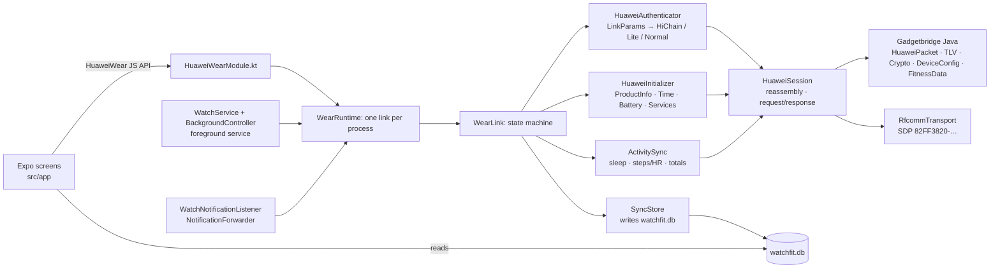

# WatchFit

WatchFit is an Android companion app for the **Huawei Watch Fit 4 / Fit 4 Pro**. It has no Huawei
Health install, no account and no cloud: data goes from the watch to the phone into a local SQLite
database and stays there.

The app has two parts:

- an Expo (SDK 57) React Native app for the screens;
- `modules/huawei-wear`, a local Expo module that implements the watch's protocol. It is a port of
  [Gadgetbridge](https://codeberg.org/Freeyourgadget/Gadgetbridge)'s Huawei support.

## How it talks to the watch

The Fit 4 uses **Bluetooth Classic RFCOMM**, not BLE GATT. This is why the earlier BLE explorer
never found a usable channel. See [`protocol/README.md`](protocol/README.md) for the frame format,
the commands used, and how the app picks an auth path.



## What works

| Feature | Status |
|---|---|
| Bonded-device list, connect, disconnect | implemented |
| Auth: HiChain (first bind with on-watch confirmation, then reconnect), HiChain Lite, normal | implemented (ported from GB) |
| Product info, time sync, battery | implemented |
| Sync per-minute steps / kcal / distance / HR / SpO₂ / resting HR, sleep segments, today's totals | implemented |
| Local storage + Today screen + raw packet log (copy to clipboard) | implemented |
| Sleep stages from TruSleep / dictionary files (file download services 0x2C and 0x0A) | implemented, gated like GB; unverified on the Fit 4 |
| Background mode: foreground service keeps the watch connected, reconnects with backoff, syncs every 30 min (configurable), starts on boot | implemented; unverified on the Fit 4 |
| Notification forwarding (app name, title, text) with a per-app list | implemented; unverified on the Fit 4 |
| Profile (height, weight, birth year, sex) and daily step goal sent to the watch | implemented; unverified on the Fit 4 |
| Write steps, distance, calories, heart rate, SpO₂, resting HR, sleep and workouts to Health Connect (for JoyoRogo and others), also from the background service | implemented; unverified on the Fit 4 |
| Workouts (sport sessions): totals, heart rate, pace splits, swim data and the GPS track, shown in the Workouts tab (stats, heart-rate bars, route as an SVG polyline, no map) | implemented, ported from GB; unverified on the Fit 4 |
| Weather on the watch: current conditions and a 24 h / 8 day forecast from Open-Meteo (no key) for the phone's coarse location or a chosen city, pushed on connect, when the watch asks, and every hour (configurable) | implemented, ported from GB; unverified on the Fit 4 |
| Find my watch (phone → watch) from the Device tab | implemented, ported from GB; unverified on the Fit 4 |
| Find my phone (watch → phone): loud ringtone on the alarm volume, vibration, notification with Stop; works from the background service | implemented, ported from GB; unverified on the Fit 4 |
| Incoming calls on the watch (caller name or number), accept / reject from the watch | implemented, ported from GB; unverified on the Fit 4 |
| Alarms: read the five event alarms and the smart alarm, add, edit, delete, enable, push | implemented, ported from GB; unverified on the Fit 4 |

The protocol layer is covered by the Gadgetbridge packet, TLV and crypto tests plus our own
session reassembly tests, 120 JVM tests in total. **It has not yet been run against a real Fit 4.**
The first connect is the real test. When you do it, save the Log tab (Copy) and add the
link parameters to `protocol/README.md` → Observations.

## Using it

1. Unbind the watch from Huawei Health. The watch can only be bound to one app at a time; a
   factory reset of the watch also works.
2. Pair the watch in **Android Settings → Bluetooth**. It shows up as `HUAWEI WATCH FIT 4-XXX`.
3. Open WatchFit → **Device** → grant Nearby devices → tap the watch → **Connect**.
   - On the first connect, confirm the pairing on the watch within 30 s.
4. Go to **Today** and tap **Sync**. The first sync pulls the last 7 days. Each later sync starts
   from the previous one, with 1 h of overlap.
5. **Settings** has the background toggle and sync interval, notification forwarding, and your
   profile and step goal. The watch you last connected from **Device** is the one background mode follows.
6. **Log** shows every TX/RX frame in hex.

### Background mode

Turn on **Keep connected in the background** in Settings. A foreground service (type
`connectedDevice`, with a low-priority notification) owns the one watch link: it connects when it
starts, reconnects after a drop (5 s, doubling up to 5 min; at once when Bluetooth turns on or the
watch's ACL link comes up), and syncs and reads the battery on a timer. After a reboot it starts again.
Sync results are written to the database by native code, so data accumulates while the app is closed.

- The first bind still has to be confirmed on the watch from the Device tab; the service never starts a bind.
- Tapping **Disconnect** in the app pauses auto-reconnect until you connect again.
- Android 13+ asks for the notification permission when you enable it. Without it the service still
  runs but its notification is hidden.
- Battery optimisation: if your phone kills the service, exempt WatchFit from battery restrictions.

### Notifications

In Settings, grant **notification access** (on Android 13+ a sideloaded app must first be allowed
under App info → ⋮ → *Allow restricted settings*), then switch on forwarding. Ongoing notifications,
group summaries, local-only ones, calls, media controls, progress bars and WatchFit's own are skipped.
Apps you have not chosen are on, except system apps; **Choose apps** overrides either way.
Notifications only reach the watch while it is connected, so use background mode to keep it connected.

### Weather

In Settings → **Weather**, switch on *Send weather to the watch*, pick °C or °F and where the weather
is for: **This phone** (asks for the coarse location permission) or **A city** (type a name, e.g.
`Bandung` or `Bandung, Indonesia`; it is looked up with Open-Meteo's geocoding). The forecast comes
from `api.open-meteo.com`; only the coordinates, rounded to about 1 km, are sent. The weather is pushed
when the watch connects, whenever the watch asks for it (opening its weather app), and every hour
(30 min to 4 h) while the watch is connected, so background mode keeps it fresh. **Update now** sends it at once.

- It is off until you switch it on. While off, a watch that asks gets a "weather disabled" reply.
- Location uses `LocationManager` (no Google Play services): the newest last-known coarse fix, else one
  fresh network fix, else the last position it stored. Without background location access Android may
  give the background service no fresh fix, so the last position is reused. Choose **A city** if that is not good enough.
- Temperatures are always sent in °C, like Gadgetbridge; the unit setting tells the watch which one to show.
- Open-Meteo has no moon rise/set, air quality or place name for a coordinate: the moon phase is computed,
  the others are not sent, and a current-location name comes from Android's `Geocoder` when the phone has one.

### Find my watch, find my phone, calls and alarms

- **Find my watch**: Device tab → *Ring the watch* / *Stop ringing* (watch connected, and it must report
  find-device support).
- **Find my phone**: on by default in Settings → *Find, calls and alarms*. When you press find-phone on the
  watch, the phone rings in a loop on the **alarm** stream at maximum volume (your alarm volume is restored
  afterwards), vibrates, and posts a high-priority notification with **Stop**. It stops when the watch says
  stop or when you tap Stop; either way the phone then tells the watch it stopped, like Gadgetbridge. It needs
  no UI, only the link, so background mode is enough. It does not use a full-screen activity.
- **Calls**: switch on *Show incoming calls on the watch* and allow Phone state (needed), Call log (the
  caller's number; Android hides it otherwise) and Contacts (shows the name instead of the number). While
  ringing, the watch shows the call; answering or ending it on the phone clears it. With *Answer and reject
  calls from the watch* on (needs the Answer phone calls permission), the watch's accept and reject buttons
  call `TelecomManager.acceptRingingCall()` / `endCall()`. There is no mute button: the watch protocol
  Gadgetbridge knows only has accept and reject. Outgoing calls are not shown.
- **Alarms**: Settings → *Watch alarms*. The screen reads the watch whenever it opens with the watch connected,
  keeps the last copy on the phone, and every change pushes the whole list and shows what the watch reports
  back. Five event alarms (name, time, weekdays) and, if the watch has one, the smart alarm.

## Permissions

| Permission | Why |
|---|---|
| `BLUETOOTH_CONNECT` (`BLUETOOTH` / `BLUETOOTH_ADMIN` up to API 30) | list bonded watches and open the RFCOMM link |
| `FOREGROUND_SERVICE`, `FOREGROUND_SERVICE_CONNECTED_DEVICE` | the background service (Android 14 requires the typed permission) |
| `POST_NOTIFICATIONS` | show the service notification (runtime prompt on Android 13+) |
| `RECEIVE_BOOT_COMPLETED` | restart background mode after a reboot or app update |
| `WAKE_LOCK` | keep the CPU awake while a reconnect or sync runs in the background |
| Notification access (special, granted in Android settings) | read posted notifications to forward them |
| `VIBRATE` | find my phone vibration |
| `READ_PHONE_STATE`, `READ_CALL_LOG`, `READ_CONTACTS` | show incoming calls on the watch: call state, the caller's number, the contact name (runtime prompt from Settings; only the first is required) |
| `ANSWER_PHONE_CALLS` | accept or reject a call from the watch (runtime prompt from Settings) |
| `android.permission.health.WRITE_STEPS`, `WRITE_DISTANCE`, `WRITE_ACTIVE_CALORIES_BURNED`, `WRITE_HEART_RATE`, `WRITE_RESTING_HEART_RATE`, `WRITE_OXYGEN_SATURATION`, `WRITE_SLEEP`, `WRITE_EXERCISE` | write the watch data to Health Connect (asked from Settings through Health Connect's own dialog; write only, no read) |
| `INTERNET` | fetch the weather and search cities from Open-Meteo (nothing else uses it) |
| `ACCESS_COARSE_LOCATION` | weather for the phone's position (runtime prompt from Settings → Weather; not needed in city mode) |

There is no `QUERY_ALL_PACKAGES`: the app chooser lists launcher apps through a `<queries>` entry.
The only internet use is weather (Open-Meteo forecast and city search), and only while weather is switched on.

## Health Connect / JoyoRogo

WatchFit can copy what the watch records into [Health Connect](https://developer.android.com/health-and-fitness/guides/health-connect),
Android's on-device health store, so other apps can read it. It only **writes**: it never reads
Health Connect. [JoyoRogo](../joyorogo) reads `ExerciseSession`, `SleepSession`, `Steps`, `Distance`
and `ActiveCaloriesBurned` (`apps/native/src/lib/health-connect.ts`), and aggregates the cumulative
ones with Health Connect's own `aggregateRecord`, which is why steps, distance and energy are
written per minute rather than as daily totals.

Turn it on in **Settings → Health Connect → Write to Health Connect**. Android shows the Health
Connect permission dialog; allow every type (JoyoRogo needs `Steps`, `Distance`,
`ActiveCaloriesBurned`, `SleepSession` and `ExerciseSession`). Enabling it also writes everything
already in the local database once; **Write everything again** repeats that. After that every sync
is exported by native code, so the background service feeds Health Connect with the app closed.
Then, in JoyoRogo, grant it read access to the same types and sync.

| Local data (`watchfit.db`) | Health Connect record | Shape |
|---|---|---|
| `step_samples.steps` | `StepsRecord` | one per minute with steps > 0 |
| `step_samples.distance` | `DistanceRecord` | one per minute, metres |
| `step_samples.calories` | `ActiveCaloriesBurnedRecord` | one per minute, kilocalories |
| `step_samples.heart_rate` | `HeartRateRecord` | one series per hour, a sample per minute |
| `step_samples.spo2` | `OxygenSaturationRecord` | one per reading, percent |
| `step_samples.resting_heart_rate` | `RestingHeartRateRecord` | one per local day (the day's latest reading) |
| `sleep_segments` | `SleepSessionRecord` with stages | spans less than 1 h apart form one session; light/deep/REM/awake map to the matching stage, spans without a stage are "sleeping" |
| `workouts` | `ExerciseSessionRecord` | one per completed workout; the type is mapped from the Huawei sport type, distance, energy and heart rate go in the notes |

Units: Gadgetbridge stores the step frame's `distance` as metres (it logs the totals as `m`) and its
`calories` as kilocalories (its workout summaries label the same watch numbers `kcal`; a source
comment there wonders whether they could be small calories, which is unconfirmed on the Fit 4).
They are written as metres and kcal. A workout's own energy is not written a second time: the
per-minute energy already covers it, and a second record would be counted twice by readers that sum it.

Re-syncs are idempotent. Each record has the client record id `watchfit:<kind>:<time or day>` and a
client record version equal to the export time, so Health Connect replaces the earlier record
instead of adding another. Records are written with the watch as the device (Huawei, the product
model the watch reported). Switching the export off keeps what was written; delete it in Health
Connect. Types you do not allow are skipped, and the last error and counts are shown in Settings.
The export needs Health Connect: built into Android 14+, a Play Store app on Android 10 to 13.

## Where data lives

`watchfit.db` in `<app files>/SQLite` is shared by the screens (expo-sqlite, read) and the native
module (`android.database.sqlite`, write, WAL with a 10 s busy timeout). The schema is one JSON file,
`modules/huawei-wear/schema/watchfit-db-migrations.json`, imported by `src/db/migrations.ts` and shipped
as an Android asset that the native side migrates from, so JS and native cannot drift. Native
upserts the same rows the JS queries used to, and advances `device.last_sync` in the same transaction.
The profile, background and notification settings are in native SharedPreferences (`watchfit_settings`).

Workouts are two more tables from migration 3: `workouts` (one row per session: watch workout number,
start/end, Huawei sport type and GB's name for it, duration, distance, calories, average/max heart
rate, steps, `summary_json` with everything else, `complete`) and `workout_points` (`workout_id`, `ts`,
`lat`, `lon`, `alt`, `hr`). GPS points have lat/lon, heart-rate samples have `hr`; a point has only
what its source had. A workout is replaced as a whole in one transaction, keyed by `start`.

**Forget pairing** deletes the stored auth key. The next connect then does a fresh bind.

## Build

Requirements: bun, JDK 17, and an Android SDK (platform 36). A physical Android 10+ phone is needed
for Bluetooth; emulators can't reach the watch.

```bash
bun install
bunx expo prebuild -p android          # generates android/ (gitignored, CNG)
bun run android                        # expo run:android: build, install, start Metro
bun run test:native                    # JVM tests for the protocol + session layers
bun run typecheck && bun run lint
```

Keep `JAVA_HOME` pointed at JDK 17 and `ANDROID_HOME` at the SDK.

## Layout

```
src/app/                  expo-router tabs: index (Device), today, workouts (list + detail stack), settings, log
src/state/                WatchProvider (link state, events), log ring buffer
src/db/                   expo-sqlite migrations (from the shared JSON) + read queries
src/features/             screen pieces (device, today, settings, log)
modules/huawei-wear/
  src/                    TS contract (HuaweiWear.types.ts, HuaweiWearModule.ts)
  schema/                 watchfit-db-migrations.json, read by JS and by native
  android/src/main/java/
    com/joyodigitama/huaweiwear/            Kotlin: transport, session, auth, init, sync, runtime/service, notifications, Expo module
    nodomain/freeyourgadget/gadgetbridge/   Gadgetbridge Java, upstream package names kept for diffing
  android/src/test/java/                    Gadgetbridge tests + HuaweiSessionTest
protocol/README.md        protocol reference + observations
```

## Updating from Gadgetbridge

The ported Java keeps GB's package names and file layout. Each modified file has a
`Modified for watch-fit` header line. To pull in upstream fixes, diff these files against GB.
The upstream base is recorded in [`NOTICE`](NOTICE).

## License

[AGPL-3.0-or-later](LICENSE). The project is derived from Gadgetbridge; see [`NOTICE`](NOTICE).
If you distribute this app, or modified versions of it, you must provide the source.
