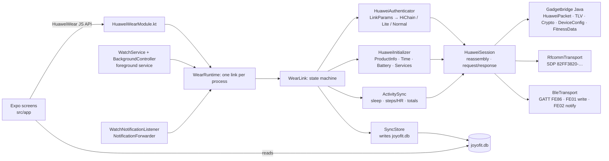
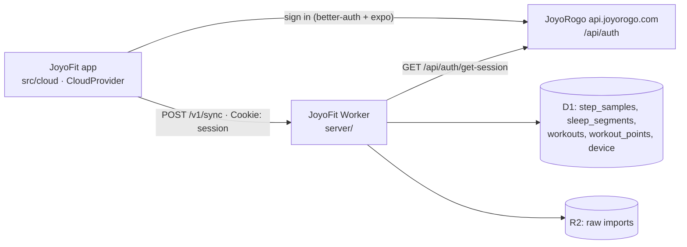

# JoyoFit

Website: <https://fit.joyorogo.com> (source in [`site/`](site/)).

JoyoFit is an Android companion app for Huawei and Honor watches. It was built for, and is tested only on, the **Huawei Watch Fit 4 Pro**; other models are experimental (see [Supported watches](#supported-watches)). It has no Huawei
Health install and no account needed: data goes from the watch to the phone into a local SQLite
database. Optionally, signing in with a JoyoRogo account uploads it to your own Cloudflare backend
(see [Cloud sync](#cloud-sync)); nothing leaves the phone before you do.

The app has two parts:

- an Expo (SDK 57) React Native app for the screens;
- `modules/huawei-wear`, a local Expo module that implements the watch's protocol. It is a port of
  [Gadgetbridge](https://codeberg.org/Freeyourgadget/Gadgetbridge)'s Huawei support.

## Supported watches

JoyoFit talks to Huawei Watch models over Bluetooth Classic (RFCOMM), the link the Watch Fit 4 Pro uses, and to Huawei and Honor bands over Bluetooth LE (GATT). The model list comes from Gadgetbridge's Huawei support (see `WatchModels.kt`). **Only the Huawei Watch Fit 4 Pro has been tested with JoyoFit.** Everything else is a best guess until someone tries it.

| Status | Watches | Notes |
| --- | --- | --- |
| **Tested** | Huawei Watch Fit 4 Pro | Checked on a real watch. |
| **Experimental** | Huawei Watch Fit 4, Huawei Watch Fit 5, Huawei Watch Fit 5 Pro, Huawei Watch Fit 3, Huawei Watch Fit 2, Huawei Watch GT 2, Huawei Watch GT 2 Pro, Huawei Watch GT 3, Huawei Watch GT 3 Pro, Huawei Watch GT 3 SE, Huawei Watch GT 4, Huawei Watch GT 5, Huawei Watch GT 5 Pro, Huawei Watch GT 6, Huawei Watch GT 6 Pro, Huawei Watch GT 7, Huawei Watch GT 7 Pro, Huawei Watch GT Runner, Huawei Watch GT Runner 2, Huawei Watch GT Cyber, Huawei Watch 3, Huawei Watch 3 Pro, Huawei Watch 4, Huawei Watch 4 Pro, Huawei Watch 5, Huawei Watch D2, Huawei Watch Ultimate, Huawei Watch Ultimate 2, Huawei TalkBand B6, Honor MagicWatch 2, Honor Watch GS 3, Honor Watch GS Pro, Honor Watch 4, Honor Watch 4 Pro | Bluetooth Classic models in Gadgetbridge's list. Never tried with JoyoFit, so some or all features may not work. |
| **Experimental** | Huawei Watch Fit, Huawei Watch GT, Huawei Watch GT 2e, Huawei Band 2, Huawei Band 2 Pro, Huawei Band 3, Huawei Band 3 Pro, Huawei Band 3e, Huawei Band 4, Huawei Band 4 Pro, Huawei Band 4e, Huawei Band 6, Huawei Band 7, Huawei Band 8, Huawei Band 9, Huawei Band 10, Huawei Band 11, Huawei Band 11 Pro, Honor Band 3, Honor Band 4, Honor Band 5, Honor Band 6, Honor Band 7, Honor Band 9, Honor Band 10, Honor Watch | Bluetooth LE (GATT) models in Gadgetbridge's list. **Untested, please report:** the LE link was ported from Gadgetbridge without a band to try it on, so connecting, pairing or sync may fail. Connect once and send the report (see below). JoyoFit lists bonded devices, so the band must show up as paired in Android's Bluetooth settings. Band 3e and 4e use a variant of the handshake. Honor Band 7, 9 and 10 use Honor's own GATT service, and Gadgetbridge calls those three experimental too. |
| **Not yet** | Honor Watch 5, Honor Watch 5 Pro, Honor Watch 6 | Honor's newer pairing (HiChain PAKE) is not implemented. |
| **Not yet** | Earphones (FreeBuds, FreeClip, FreeArc, FreeLace, Earbuds) | Not watches; they do not speak the watch protocol. |

A Huawei or Honor watch that is not in the list is **unknown**: JoyoFit tries to connect to it like a Huawei watch (over Bluetooth Classic, or over Bluetooth LE if Android reports the device as LE only), and it may not work. Anything that is not a Huawei or Honor watch is refused.

### Help support your watch

If you own an experimental or unknown model, connecting once helps a lot:

1. Pair the watch and connect it in JoyoFit.
2. Open the **Watch** tab, then **Help support your watch**, then **Report on GitHub**.
3. The app opens a prefilled [watch report issue](https://github.com/dzulfikar08/joyofit/issues/new?template=watch-report.yml) and copies the full report to the clipboard. Say what works and what does not, paste the report into the **Log** field, and submit. **Share as text** sends the same report anywhere else.

The report is plain text: app version, phone, watch model and software, supported commands, ExpandCapability and the connect log. It has no Bluetooth addresses and no serial number.

## How it talks to the watch

The Fit 4 Pro (and the other Classic watches) use **Bluetooth Classic RFCOMM**, not BLE GATT. This is why the earlier BLE explorer
never found a usable channel. Huawei and Honor bands speak the same packet protocol over **Bluetooth LE GATT** (service `0xFE86`,
write `FE01`, notifications `FE02`; Honor Band 7, 9 and 10 use Honor's own service), which `BleTransport` carries; that path is
experimental and has not been tried on a real band. `WatchModels.kt` picks the transport per model. See [`protocol/README.md`](protocol/README.md) for the frame format,
the commands used, and how the app picks an auth path.



## What works

| Feature | Status |
|---|---|
| Bonded-device list, connect, disconnect | implemented |
| Auth: HiChain (first bind with on-watch confirmation, then reconnect), HiChain Lite, normal | implemented (ported from GB) |
| Product info, time sync, battery | implemented |
| Sync per-minute steps / kcal / distance / HR / SpO₂ / resting HR, sleep segments, today's totals | implemented |
| Heart rate, SpO₂ and TruSleep switched on in the watch on every connect (Settings → Watch & sync → Heart rate and sensors, default on; optional high/low heart-rate alerts, default off); live heart rate on Today while it is on screen; the hero shows the live bpm, else the newest stored one with its age, else `--` | implemented, ported from GB; the realtime push layout is a guess (GB has no parser), unverified on the Fit 4 |
| Local storage + Today screen + raw packet log (copy to clipboard) | implemented |
| Sleep stages from TruSleep / dictionary files (file download services 0x2C and 0x0A) | implemented, gated like GB; unverified on the Fit 4 |
| Background mode: foreground service keeps the watch connected, reconnects with backoff, syncs every 30 min (configurable), starts on boot | implemented; unverified on the Fit 4 |
| Notification forwarding (app name, title, text) with a per-app list | implemented; unverified on the Fit 4 |
| Profile (height, weight, birth year, sex) and daily step goal sent to the watch | implemented; unverified on the Fit 4 |
| Write steps, distance, calories, heart rate, SpO₂, resting HR, sleep and workouts to Health Connect (for JoyoRogo and others), also from the background service | implemented; unverified on the Fit 4 |
| Workouts (sport sessions): totals, heart rate, pace splits, swim data and the GPS track, shown in the Workouts tab (stats, heart-rate bars, route as an SVG polyline, no map) | implemented, ported from GB; unverified on the Fit 4 |
| Weather on the watch: current conditions and a 24 h / 8 day forecast from Open-Meteo (no key) for the phone's coarse location or a chosen city, pushed on connect, when the watch asks, and every hour (configurable) | implemented, ported from GB; unverified on the Fit 4 |
| Find my watch (phone → watch) from the Watch tab | implemented, ported from GB; unverified on the Fit 4 |
| Find my phone (watch → phone): loud ringtone on the alarm volume, vibration, notification with Stop; works from the background service | implemented, ported from GB; unverified on the Fit 4 |
| Incoming calls on the watch (caller name or number), accept / reject from the watch | implemented, ported from GB; unverified on the Fit 4 |
| Alarms: read the five event alarms and the smart alarm, add, edit, delete, enable, push | implemented, ported from GB; unverified on the Fit 4 |
| Watch faces: list with the active one, set active, delete, install a `.hwt` from Huawei Theme Studio Pro with upload progress | implemented, ported from GB; unverified on the Fit 4 (whether it accepts unsigned faces is not known) |
| Customize the editable faces already on the watch (Watch faces → Customize): read a face's selected style, background, typeface, hands, colour and widget options, change them, Apply, Revert | native codec and `WatchfaceCustomizer` (DataSync events 800100008 / 800100009) **implemented from the Huawei Health RE, UNVERIFIED on the watch**; JVM codec tests pass; options are labelled by position because the watch sends no names or counts |
| Fall detection switch, SOS text relay (`SmsManager`), DST answer, morning sleep report, cycle log with watch calendar and reminders (Settings → Safety, Settings → Cycle) | implemented from the Huawei Health RE (DataSync, service `0x32`); unverified on the Fit 4 |
| Health metrics from the watch's data dictionary over P2P (service `0x34`): skin temperature, HRV, stress / emotion, sleep apnea, plus raw capture of arterial stiffness and arrhythmia; stored in `health_metrics`, shown on **Today → Health** with the latest value and a 7-day sparkline; metrics the watch does not support (blood pressure, altitude, AMS here) are skipped and listed as such | implemented, ported from GB (`HuaweiP2PDataDictionarySyncService`), gated by ExpandCapability like GB; unverified on the Fit 4 (see `protocol/README.md` → P2P) |
| Healthy Living (Health Clover) tasks: answers the watch's request with steps, exercise, sleep, calorie intake and clover progress from JoyoFit data (Settings → Health & cloud) | implemented from the Huawei Health RE (protobuf field numbers read from the APK's generated classes); unverified on the Fit 4, clover leaf mapping is a documented substitution |
| Running courses (warm-up, intervals, cool-down by time or distance with pace / heart-rate / cadence targets) pushed to the watch (Settings → Advanced → Running courses) | **experimental, off by default**: format from the Huawei Health RE, the watch's acknowledgement and some fields are not known; see `protocol/README.md` → P2P (c) for exactly what is missing |
| Calorie intake from JoyoRogo on the watch's calorie card, weight / resting metabolism / Health Glance answers, activity-ring goals and reminders (Settings → Meals on watch, Goals and reminders) | implemented from the Huawei Health RE over a new DataSync framework; **unverified on the Fit 4 Pro** |

The protocol layer is covered by the Gadgetbridge packet, TLV and crypto tests plus our own
session reassembly tests and fake-watch tests for downloads and watch face upload, 222 JVM tests in total. **It has not yet been run against a real Fit 4.**
The first connect is the real test. When you do it, save the log (Settings → Advanced → Log → Copy) and add the
link parameters to `protocol/README.md` → Observations.

## Using it

1. Unbind the watch from Huawei Health. The watch can only be bound to one app at a time; a
   factory reset of the watch also works.
2. Pair the watch in **Android Settings → Bluetooth**. It shows up as `HUAWEI WATCH FIT 4-XXX`.
3. Open JoyoFit → **Watch** → grant Nearby devices → tap the watch → **Connect**.
   - On the first connect, confirm the pairing on the watch within 30 s.
4. Go to **Today** and tap **Sync now** (or pull down). The first sync pulls the last 7 days. Each later sync starts
   from the previous one, with 1 h of overlap.
5. **Settings** is a grouped menu: Watch & sync (background toggle, sync interval, heart rate and sensors), Notifications & calls,
   Weather, Health & cloud, Profile & goal and Advanced. The watch you last connected from **Watch** is the one
   background mode follows.
6. **Settings → Advanced → Log** shows every TX/RX frame in hex.

### Background mode

Turn on **Keep connected in the background** in Settings. A foreground service (type
`connectedDevice`, with a low-priority notification) owns the one watch link: it connects when it
starts, reconnects after a drop (5 s, doubling up to 5 min; at once when Bluetooth turns on or the
watch's ACL link comes up), and syncs and reads the battery on a timer. After a reboot it starts again.
Sync results are written to the database by native code, so data accumulates while the app is closed.

- The first bind still has to be confirmed on the watch from the Watch tab; the service never starts a bind.
- Tapping **Disconnect** in the app pauses auto-reconnect until you connect again.
- Android 13+ asks for the notification permission when you enable it. Without it the service still
  runs but its notification is hidden.
- Battery optimisation: if your phone kills the service, exempt JoyoFit from battery restrictions.

### Notifications

In Settings, grant **notification access** (on Android 13+ a sideloaded app must first be allowed
under App info → ⋮ → *Allow restricted settings*), then switch on forwarding. Ongoing notifications,
group summaries, local-only ones, calls, media controls, progress bars and JoyoFit's own are skipped.
Apps you have not chosen are on, except system apps; **Notification apps** (Settings → Notifications & calls) overrides either way.
Notifications only reach the watch while it is connected, so use background mode to keep it connected.

### Weather

In Settings → **Weather**, switch on *Send weather to the watch*, pick °C or °F and where the weather
is for: **This phone** (asks for the coarse location permission) or **A city** (type a name, e.g.
`Bandung` or `Bandung, Indonesia`; it is looked up with Open-Meteo's geocoding). The forecast comes
from `api.open-meteo.com`; only the coordinates, rounded to about 1 km, are sent. The weather is pushed
when the watch connects, whenever the watch asks for it (opening its weather app), and every hour
(30 min to 4 h) while the watch is connected, so background mode keeps it fresh. **Update now** sends it at once.

- It is off until you switch it on. While off, a watch that asks gets a "weather disabled" reply.
- Location uses `LocationManager` (no Google Play services): the newest last-known coarse fix, else one
  fresh network fix, else the last position it stored. Without background location access Android may
  give the background service no fresh fix, so the last position is reused. Choose **A city** if that is not good enough.
- Temperatures are always sent in °C, like Gadgetbridge; the unit setting tells the watch which one to show.
- Open-Meteo has no moon rise/set, air quality or place name for a coordinate: the moon phase is computed,
  the others are not sent, and a current-location name comes from Android's `Geocoder` when the phone has one.

### Find my watch, find my phone, calls and alarms

- **Find my watch**: Watch tab → *Ring the watch* / *Stop ringing* (watch connected, and it must report
  find-device support).
- **Find my phone**: on by default in Settings → *Notifications & calls*. When you press find-phone on the
  watch, the phone rings in a loop on the **alarm** stream at maximum volume (your alarm volume is restored
  afterwards), vibrates, and posts a high-priority notification with **Stop**. It stops when the watch says
  stop or when you tap Stop; either way the phone then tells the watch it stopped, like Gadgetbridge. It needs
  no UI, only the link, so background mode is enough. It does not use a full-screen activity.
- **Calls**: switch on *Show incoming calls on the watch* and allow Phone state (needed), Call log (the
  caller's number; Android hides it otherwise) and Contacts (shows the name instead of the number). While
  ringing, the watch shows the call; answering or ending it on the phone clears it. With *Answer and reject
  calls from the watch* on (needs the Answer phone calls permission), the watch's accept and reject buttons
  call `TelecomManager.acceptRingingCall()` / `endCall()`. There is no mute button: the watch protocol
  Gadgetbridge knows only has accept and reject. Outgoing calls are not shown.
- **Alarms**: Watch tab → *Alarms*. The screen reads the watch whenever it opens with the watch connected,
  keeps the last copy on the phone, and every change pushes the whole list and shows what the watch reports
  back. Five event alarms (name, time, weekdays) and, if the watch has one, the smart alarm.

### Watch faces

**Watch** tab → *Watch faces*. The screen reads the watch's face list when it
opens: name, id and version, an *(active)* marker, and *preinstalled* for the factory faces. *Set active* switches the watch to
that face, *Delete* removes it (not offered for preinstalled faces). After each of these the app reads the list again and
reports an error if the watch did not do what it was asked.

**Customize** (shown on faces whose `editable` bit is set; UNVERIFIED that the bit means "has options"). Opens an editor that asks the
watch for the face's current options and shows what it reports: a picker each for style, background, typeface, hands (and symbol, time,
scale, dual when the face has them), a colour palette with an optional custom colour, and one picker per widget slot. *Apply* sends the
picks and then asks the watch again; the screen says which picks the watch did not take. *Revert* puts back the options the face had when
you opened the editor. If the user edits the face on the watch, the watch's report updates the screen.

- **Options are numbered, not named.** The watch reports only which option is selected. How many exist, and what they look like, lives in
  Huawei's per-face editor page, which JoyoFit does not have. Each picker starts with six numbers and grows with *More*; an index the face
  does not have is expected to be refused, and the apply result then lists it.
- Needs ExpandCapability 84 (DataSync events). Without it the editor says so; the decision is logged as `FaceCustom: … ExpandCapability 84 …`.
- Status: wire format **UNVERIFIED** (read from Huawei Health's `CustomConfigWatchFaceService`; `protocol/README.md` → *Editing a face's
  options*, including the device test to run). Codec **VERIFIED by JVM tests** against the byte layout derived from `cqe`. The screen,
  its hook and the native module compile and lint clean but were **not exercised on the watch**.

*Install from file* opens Android's file picker. Pick a `.hwt` exported from **Huawei Theme Studio Pro**. The Watch Fit 4 and
Fit 4 Pro screen is 480 x 408 px (Theme Studio Pro calls it 408 x 480; GB's theme version `HWHD13`). The app checks the package's
theme version against the screen size the watch reports and refuses a face made for another screen before sending anything.
The upload shows a progress bar; the watch pulls the data in chunks of its own choosing.

- **Unsigned faces.** Whether the Fit 4 accepts a face that Huawei did not sign is not known yet. If the watch refuses, the screen
  and the Log tab show the exact status code it returned (`Upload: rejected by the watch at … status code N`). If it takes the
  upload but the face never shows up in its list, the result says so ("the watch does not list the new face"). Please note either
  outcome, with the Log lines, in `protocol/README.md` → Observations.
- Only one operation runs on the link at a time: a sync that starts during an upload waits for it.
- GB does not check for the `0x28` upload service in the watch's service list, and neither do we; the Fit 4 does not list it.

### Safety: fall detection, SOS texts, morning sleep report (Settings → Safety)

- **Fall detection** shows the watch's own switch and sets it (DataSync config `900500038`). It is offered only when the watch reports what Huawei Health
  checks (ExpandCapability 83 and SupportedCommands `0x33/01`); the Fit 4 Pro's service list has no `33`, so there the row says "not available" and why.
- **SOS texts.** When the watch asks for an SOS SMS (event `800100040`) the phone sends it with `SmsManager` (long texts are split) and tells the watch if it
  went out. It never sends unless you switch it on, grant SMS permission and a SIM is ready; otherwise it answers the watch "failed" so nobody waits for help that
  is not coming. The watch decides the number and the text; JoyoFit picks no recipient. "Check without sending" shows what would happen and sends nothing. The log
  shows only the last two digits of the number and the message length.
- **Morning sleep report.** Once each morning, after the first sync that holds a night of at least 3 h that ended today, the watch shows how long you slept, the times
  and the stages (event `80030001`). On by default; "Send last night's report now" pushes it for testing.
- **Time zones and DST** need no setting: when the watch asks (event `800100020`) JoyoFit answers with the next transition of the phone's zone.

### Cycle (Settings → Cycle)

Log when a period starts and ends, flow and cramps (0 to 3), add earlier periods, and see an estimate of the next period and the fertile window from the average of
your logged cycles (28 days with no history). The estimate is not medical advice. The switch "Show the cycle calendar on the watch" (off by default) sends the
capability, the reminder switches and, when the watch asks, the cycle list, daily status and flow/cramps over service `0x32` and DataSync dictionary `400018`
(`protocol/README.md`). Unverified on the Fit 4: the exact fields were read from Huawei Health, never seen on the wire.

### Meals on the watch, body data and ring goals (DataSync, service `0x37`)

All of these ride the DataSync framework (`DataSyncService`: the four "sample" commands `37/01..04`, an inbound dispatcher keyed by package and id, capability gates
ExpandCapability 83 / 84 / 85 / 173). **None of it has been seen working on the Fit 4 Pro yet**: the layouts come from Huawei Health 17.0.8.300 static analysis (`protocol/README.md`
→ Calorie intake, Body data, Activity goals). Every send, every watch request and every gate decision is in the Log (`adb logcat -d -s JoyoFit:V`, lines starting `DataSync`, `Diet:`, `Body:`, `Goals:`, `Health Glance:`).

- **Meals on watch** (Settings → Meals on watch). JoyoRogo's `food.listByDate` (today's diary: kcal, macros, meal type), `profile.myProfile` (daily kcal target, BMR, goal weight) and
  `weight.history` (latest weigh-in) are read over JoyoRogo's oRPC API (`POST <server>/rpc/<router>/<procedure>`, the session cookie in a `Cookie` header, read-only) and handed to the
  watch: config `900300023` (goals, per-meal budget) and `900300022` (goal weight), then the whole day's meal slots as dictionary `600002`, with empty placeholders for
  the meals not eaten yet. Meals map `sarapan` 10, `makan_siang` 20, `makan_malam` 30, `snack` 40; an item logged 3 h or more after the first of its meal goes to the extra slot 11 / 21 / 31,
  which the watch only gets with ExpandCapability 215 (else it is folded into 40). It refreshes when the app opens, returns to the foreground, after each sync and when the watch connects;
  **Push now** does it at once. The watch's own requests are answered from the stored day (`{event:1}` the meals, `{event:5}` the weight, `500018` the resting metabolism, `80030004` "not VIP").
  A meal quick-logged on the watch (`{event:6}`) is stored, acknowledged (`{punchResult:0,event:6}`, needs bit 215) and written to JoyoRogo as a diary item by the app (`food.add`); until then it stays on the phone.
  - **Limitation.** The JoyoRogo sign-in lives in `expo-secure-store` and native code cannot read it, so the background service cannot refresh from JoyoRogo. With the app closed it answers from the last day the
    app stored, rolled over to an empty new day with the same goals; a watch meal logged then is written to JoyoRogo the next time the app opens.
  - JoyoRogo has no body fat or blood pressure, so the Health Glance card (event `80030006`) gets only height, weight and BMI; unknown fields are left out, as Huawei does.
- **Goals and reminders** (Settings → Goals and reminders). Steps, active kcal (sent as kcal x 1000 like Gadgetbridge), exercise minutes and stand hours, plus the stand, progress and goal-reached
  reminders, sent as configs `900200006`..`900200009`, the bundle `900200002` and `900200004` / `900200010` / `900200011` on every save, and on every connect once you have saved goals (nothing is pushed before, so goals set on the watch survive). Defaults are Huawei's:
  10 000 steps, 300 kcal, 30 min, 12 h, reminders on (the steps goal is the profile's daily step goal until you save it here, and afterwards the two stay equal). If the watch changes a goal itself, JoyoFit stores it.

## JoyoFit Studio

[`web/`](web/README.md) is a watch face editor for the Fit 4 and Fit 4 Pro, hosted as a Cloudflare Worker with static assets
at <https://joyofit-studio.dzulfikar-at.workers.dev>. You design a 408 x 480 face in the browser (time, date, analog hands,
steps, heart rate and battery, progress rings, images, solid, gradient or photo backgrounds, six templates) against a
simulated watch, and export a `.hwt` that this app installs with **Watch faces → Install from file**. Nothing leaves the
browser. It builds on [`packages/hwt`](packages/hwt/README.md), the TypeScript `.hwt` codec.

- Faces are unofficial and unsigned; whether the Fit 4 accepts them is the open question above.
- Elements whose value ids are known only from sample faces are marked *Unconfirmed* and can be left out of the export;
  elements with no known id (calories, AM/PM) are *Preview only* and never exported. The export dialog lists both, plus
  the package size against Huawei's limits.
- Setup, tests, deploy and the element-to-layout mapping are in [`web/README.md`](web/README.md).

## Permissions

| Permission | Why |
|---|---|
| `BLUETOOTH_CONNECT` (`BLUETOOTH` / `BLUETOOTH_ADMIN` up to API 30) | list bonded watches and open the RFCOMM or Bluetooth LE (GATT) link; no scan or location permission is needed for either, JoyoFit connects to a device you already paired |
| `FOREGROUND_SERVICE`, `FOREGROUND_SERVICE_CONNECTED_DEVICE` | the background service (Android 14 requires the typed permission) |
| `POST_NOTIFICATIONS` | show the service notification (runtime prompt on Android 13+) |
| `RECEIVE_BOOT_COMPLETED` | restart background mode after a reboot or app update |
| `WAKE_LOCK` | keep the CPU awake while a reconnect or sync runs in the background |
| Notification access (special, granted in Android settings) | read posted notifications to forward them |
| `VIBRATE` | find my phone vibration |
| `READ_PHONE_STATE`, `READ_CALL_LOG`, `READ_CONTACTS` | show incoming calls on the watch: call state, the caller's number, the contact name (runtime prompt from Settings; only the first is required). The Google Play build has only `READ_PHONE_STATE`: the watch shows "Incoming call" without a caller |
| `ANSWER_PHONE_CALLS` | accept or reject a call from the watch (runtime prompt from Settings) |
| `android.permission.health.WRITE_STEPS`, `WRITE_DISTANCE`, `WRITE_ACTIVE_CALORIES_BURNED`, `WRITE_HEART_RATE`, `WRITE_RESTING_HEART_RATE`, `WRITE_OXYGEN_SATURATION`, `WRITE_SLEEP`, `WRITE_EXERCISE` | write the watch data to Health Connect (asked from Settings through Health Connect's own dialog; write only, no read) |
| `INTERNET` | fetch the weather and search cities from Open-Meteo; sign in with JoyoRogo and upload to the JoyoFit cloud server (Settings → Health & cloud → Cloud) |
| `SEND_SMS` | send the SOS text the watch asks for, only with Settings → Safety → "Send SOS texts for the watch" switched on (runtime prompt from that switch; off by default). Not in the Google Play build, which tells the watch that no SMS was sent |
| `ACCESS_COARSE_LOCATION` | weather for the phone's position (runtime prompt from Settings → Weather; not needed in city mode) |

There is no `QUERY_ALL_PACKAGES`: the app chooser lists launcher apps through a `<queries>` entry.
Internet use: weather (Open-Meteo forecast and city search, only while weather is switched on) and, after you sign in under Settings → Health & cloud → Cloud, JoyoRogo's auth server and your JoyoFit cloud server.

## Health Connect / JoyoRogo

JoyoFit can copy what the watch records into [Health Connect](https://developer.android.com/health-and-fitness/guides/health-connect),
Android's on-device health store, so other apps can read it. It only **writes**: it never reads
Health Connect. [JoyoRogo](../joyorogo) reads `ExerciseSession`, `SleepSession`, `Steps`, `Distance`
and `ActiveCaloriesBurned` (`apps/native/src/lib/health-connect.ts`), and aggregates the cumulative
ones with Health Connect's own `aggregateRecord`, which is why steps, distance and energy are
written per minute rather than as daily totals.

Turn it on in **Settings → Health & cloud → Write to Health Connect**. Android shows the Health
Connect permission dialog; allow every type (JoyoRogo needs `Steps`, `Distance`,
`ActiveCaloriesBurned`, `SleepSession` and `ExerciseSession`). Enabling it also writes everything
already in the local database once; **Write everything again** repeats that. After that every sync
is exported by native code, so the background service feeds Health Connect with the app closed.
Then, in JoyoRogo, grant it read access to the same types and sync.

| Local data (`joyofit.db`) | Health Connect record | Shape |
|---|---|---|
| `step_samples.steps` | `StepsRecord` | one per minute with steps > 0 |
| `step_samples.distance` | `DistanceRecord` | one per minute, metres |
| `step_samples.calories` | `ActiveCaloriesBurnedRecord` | one per minute, kilocalories |
| `step_samples.heart_rate` | `HeartRateRecord` | one series per hour, a sample per minute |
| `step_samples.spo2` | `OxygenSaturationRecord` | one per reading, percent |
| `step_samples.resting_heart_rate` | `RestingHeartRateRecord` | one per local day (the day's latest reading) |
| `sleep_segments` | `SleepSessionRecord` with stages | spans less than 1 h apart form one session; light/deep/REM/awake map to the matching stage, spans without a stage are "sleeping" |
| `workouts` | `ExerciseSessionRecord` | one per completed workout; the type is mapped from the Huawei sport type, distance, energy and heart rate go in the notes |

Units: Gadgetbridge stores the step frame's `distance` as metres (it logs the totals as `m`) and its
`calories` as kilocalories (its workout summaries label the same watch numbers `kcal`; a source
comment there wonders whether they could be small calories, which is unconfirmed on the Fit 4).
They are written as metres and kcal. A workout's own energy is not written a second time: the
per-minute energy already covers it, and a second record would be counted twice by readers that sum it.

Re-syncs are idempotent. Each record has the client record id `joyofit:<kind>:<time or day>` and a
client record version equal to the export time, so Health Connect replaces the earlier record
instead of adding another. Records are written with the watch as the device (Huawei, the product
model the watch reported). Switching the export off keeps what was written; delete it in Health
Connect. Types you do not allow are skipped, and the last error and counts are shown in Settings.
The export needs Health Connect: built into Android 14+, a Play Store app on Android 10 to 13.

## Cloud sync

Settings → Health & cloud → **Cloud** signs in with your **JoyoRogo account** and uploads the local database to a
separate Cloudflare Worker you deploy yourself ([`server/`](server/README.md): Hono, D1, R2). Upload only: the
app does not read from the cloud yet, and the Huawei-export importer is not written (the server already
has `POST /v1/imports`, which stores a raw file in R2 and records an `imports` row for it).



- **Sign-in.** `@better-auth/expo` against JoyoRogo's server (default `https://api.joyorogo.com`, the URL JoyoRogo's
  own app uses; override with `EXPO_PUBLIC_JOYOROGO_URL` or `expo.extra.joyorogoUrl`). It opens JoyoRogo's Google
  sign-in in the browser and returns to the `joyofit://` scheme. The session cookies live in `expo-secure-store`
  (Android Keystore) and are read from JS only: **native code, including the background service, cannot use
  them, so uploads run from the JS app, not the service.** JoyoRogo must trust the `joyofit://` scheme, see
  [`server/JOYOROGO_PATCH.md`](server/JOYOROGO_PATCH.md).
- **Server URL.** Deploy `server/` and build the app with `EXPO_PUBLIC_JOYOFIT_CLOUD_URL=https://…` (or
  `expo.extra.cloudUrl` in `app.json`). Without it the Cloud section says so and nothing is uploaded.
- **What is uploaded, and when.** Step samples, sleep segments, workouts with their points, and the device
  row. An upload runs 2 s after every sync the app sees, when the app returns to the foreground, and on
  **Sync now**; rows the background service stored while the app was closed go up at the next of those.
  Settings shows the account, the last cloud sync and the rows still waiting.
- **Incremental by cursor.** Migration 4 adds a `rev` column to `step_samples`, `sleep_segments` and `workouts`
  and triggers that stamp every insert or update (from JS or native) with the table's next `cloud_cursor.seq`.
  `cloud_cursor.uploaded` is the last `rev` the server accepted; an upload sends `rev > uploaded` in batches
  (2 000 samples, 500 sleep segments, up to 5 workouts / 15 000 points) and moves the cursor only after each
  batch succeeded. `cloud_state` keeps the account, the last sync time and the last error. Signing in as another
  JoyoRogo account resets the cursors so that account gets everything.
- **Retries.** Network errors, timeouts, 408/425/429 and 5xx are retried 3 times with backoff (1 s, 2 s, 4 s,
  or the server's `Retry-After`); a failed run leaves the cursors where they were. A row the server rejects as
  invalid (400) is isolated by halving the batch and skipped so it cannot block the rest.
- **Idempotent.** The server upserts on `(user, key)` and ignores identical rows, so replays and the 1 h
  overlap of each watch sync cost nothing. A workout is replaced as a whole with its points; a track over
  30 000 points is thinned evenly before upload.
- **Not synced:** deletions, the profile, alarms and settings.

## Where data lives

`joyofit.db` in `<app files>/SQLite` is shared by the screens (expo-sqlite, read) and the native
module (`android.database.sqlite`, write, WAL with a 10 s busy timeout). The schema is one JSON file,
`modules/huawei-wear/schema/joyofit-db-migrations.json`, imported by `src/db/migrations.ts` and shipped
as an Android asset that the native side migrates from, so JS and native cannot drift. Native
upserts the same rows the JS queries used to, and advances `device.last_sync` in the same transaction.
The profile, background and notification settings are in native SharedPreferences (`joyofit_settings`).

Workouts are two more tables from migration 3: `workouts` (one row per session: watch workout number,
start/end, Huawei sport type and GB's name for it, duration, distance, calories, average/max heart
rate, steps, `summary_json` with everything else, `complete`) and `workout_points` (`workout_id`, `ts`,
`lat`, `lon`, `alt`, `hr`). GPS points have lat/lon, heart-rate samples have `hr`; a point has only
what its source had. A workout is replaced as a whole in one transaction, keyed by `start`.

The cycle log is two tables from the cycle migration: `cycle_periods` (`start` and `end` as local `YYYY-MM-DD`, `end` NULL while a period is going on, `modified`
unix seconds) and `cycle_days` (one row per day with `flow` and `cramps` 0 to 3). It never leaves the phone: it is not part of the cloud upload or Health Connect.
The switches of fall detection, the SOS relay, the sleep report and the cycle calendar are in `joyofit_watch_extras` SharedPreferences.

The P2P health metrics are two tables from the `health_metrics` migration: `health_metrics` (`type`, `ts` and `last_ts` in unix seconds, `value` = the number a chart plots or NULL,
`values_json` with every field; one row per dictionary entry, keyed by `(type, ts)`) and `health_metric_status` (per metric: the ExpandCapability gate in words, whether the watch
supports it, the last check / sync, rows stored, a note). Neither is part of the cloud upload yet. Healthy Living and course switches are in `joyofit_p2p` SharedPreferences.

The DataSync features keep their state in `diet_day` (the latest day: `date`, `meals_json`, `goals_json`, `updated_at`, `pushed_at`) and `body_metrics` (key / value: weight, body fat, resting
metabolism, blood pressure, each with its time), both from the `diet_day` migration, so the background service can answer the watch with JS closed. Ring goals and reminders are in
`joyofit_goals` SharedPreferences, the push status in `joyofit_diet`. None of it is part of the cloud upload.

**Forget pairing** deletes the stored auth key. The next connect then does a fresh bind.

## Build

Requirements: bun, JDK 17, and an Android SDK (platform 36). A physical Android 10+ phone is needed
for Bluetooth; emulators can't reach the watch.

```bash
bun install
bunx expo prebuild -p android          # generates android/ (gitignored, CNG)
bun run android                        # expo run:android: build, install, start Metro
bun run test:native                    # JVM tests for the protocol + session layers
bun run typecheck && bun run lint
```

Keep `JAVA_HOME` pointed at JDK 17 and `ANDROID_HOME` at the SDK.

### Release builds: sideload APK and Google Play AAB

Both are signed with `keystore/keystore.properties` (restore it as described in `~/.config/joyofit/KEYSTORE_BACKUP.md`) and
get `versionCode` = minutes since 2024-01-01 UTC (`plugins/with-version-code.js`), so every build is newer than the last.

```bash
scripts/build-release.sh          # dist/joyofit-<versionCode>.apk: every permission, SOS texts and caller names work
scripts/build-release.sh --play   # dist/joyofit-play-<versionCode>.aab: the Google Play build
```

`--play` sets `JOYOFIT_DISTRIBUTION=play`. Gradle (`modules/huawei-wear/android/build.gradle`) then merges
`src/play/AndroidManifest.xml`, which removes `SEND_SMS`, `READ_CALL_LOG` and `READ_CONTACTS`, and the app reads the native
constant `HuaweiWear.distribution` (`'play'` or `'sideload'`) to hide the features that need them. The script fails if the
AAB's merged manifest still has a restricted permission. Publishing on Google Play: [`docs/play-store.md`](docs/play-store.md).

## Layout

```
src/app/                  expo-router: four tabs, index (Today), workouts (list + detail stack), watch (status, alarms, faces stack), settings (menu stack, with Log and About); /today, /log, /alarms and /watchfaces redirect to their new place
src/state/                WatchProvider (link state, events), log ring buffer
src/db/                   expo-sqlite migrations (from the shared JSON) + read queries + cloud cursors (cloud.ts)
src/cloud/                JoyoRogo sign-in (better-auth client), cloud API client with retries, incremental uploader
src/features/             screen pieces (device, today, settings, log, alarms, watchfaces)
modules/huawei-wear/
  src/                    TS contract (HuaweiWear.types.ts, HuaweiWearModule.ts)
  schema/                 joyofit-db-migrations.json, read by JS and by native
  android/src/main/java/
    com/joyodigitama/huaweiwear/            Kotlin: transport, session, auth, init, sync, runtime/service, notifications, Expo module
    nodomain/freeyourgadget/gadgetbridge/   Gadgetbridge Java, upstream package names kept for diffing
  android/src/test/java/                    Gadgetbridge tests + HuaweiSessionTest
protocol/README.md        protocol reference + observations
server/                   JoyoFit cloud Worker (Hono, D1, R2): see server/README.md
web/                      JoyoFit Studio watch face editor (Vite + React, Cloudflare Worker with static assets): see web/README.md
```

## Updating from Gadgetbridge

The ported Java keeps GB's package names and file layout. Each modified file has a
`Modified for watch-fit` header line. To pull in upstream fixes, diff these files against GB.
The upstream base is recorded in [`NOTICE`](NOTICE).

## License

[AGPL-3.0-or-later](LICENSE). The project is derived from Gadgetbridge; see [`NOTICE`](NOTICE).
If you distribute this app, or modified versions of it, you must provide the source.
