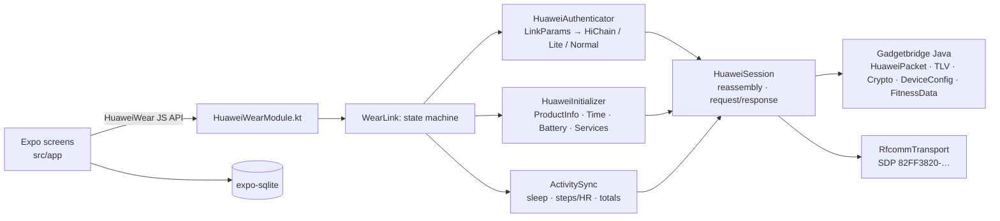

# WatchFit

WatchFit is an Android companion app for the **Huawei Watch Fit 4 / Fit 4 Pro**. It has no Huawei
Health install, no account and no cloud: data goes from the watch to the phone into a local SQLite
database and stays there.

The app has two parts:

- an Expo (SDK 57) React Native app for the screens;
- `modules/huawei-wear`, a local Expo module that implements the watch's protocol. It is a port of
  [Gadgetbridge](https://codeberg.org/Freeyourgadget/Gadgetbridge)'s Huawei support.

## How it talks to the watch

The Fit 4 uses **Bluetooth Classic RFCOMM**, not BLE GATT. This is why the earlier BLE explorer
never found a usable channel. See [`protocol/README.md`](protocol/README.md) for the frame format,
the commands used, and how the app picks an auth path.



## What works

| Feature | Status |
|---|---|
| Bonded-device list, connect, disconnect | implemented |
| Auth: HiChain (first bind with on-watch confirmation, then reconnect), HiChain Lite, normal | implemented (ported from GB) |
| Product info, time sync, battery | implemented |
| Sync per-minute steps / kcal / distance / HR / SpO₂ / resting HR, sleep segments, today's totals | implemented |
| Local storage + Today screen + raw packet log (copy to clipboard) | implemented |
| Background sync, notifications, workouts with GPS, TruSleep files, settings | not implemented |

The protocol layer is covered by the Gadgetbridge packet, TLV and crypto tests plus our own
session reassembly tests, 81 JVM tests in total. **It has not yet been run against a real Fit 4.**
The first connect is the real test. When you do it, save the Log tab (Copy) and add the
link parameters to `protocol/README.md` → Observations.

## Using it

1. Unbind the watch from Huawei Health. The watch can only be bound to one app at a time; a
   factory reset of the watch also works.
2. Pair the watch in **Android Settings → Bluetooth**. It shows up as `HUAWEI WATCH FIT 4-XXX`.
3. Open WatchFit → **Device** → grant Nearby devices → tap the watch → **Connect**.
   - On the first connect, confirm the pairing on the watch within 30 s.
4. Go to **Today** and tap **Sync**. The first sync pulls the last 7 days. Each later sync starts
   from the previous one, with 1 h of overlap.
5. **Log** shows every TX/RX frame in hex.

**Forget pairing** deletes the stored auth key. The next connect then does a fresh bind.

## Build

Requirements: bun, JDK 17, and an Android SDK (platform 36). A physical Android 10+ phone is needed
for Bluetooth; emulators can't reach the watch.

```bash
bun install
bunx expo prebuild -p android          # generates android/ (gitignored, CNG)
bun run android                        # expo run:android: build, install, start Metro
bun run test:native                    # JVM tests for the protocol + session layers
bun run typecheck && bun run lint
```

Keep `JAVA_HOME` pointed at JDK 17 and `ANDROID_HOME` at the SDK.

## Layout

```
src/app/                  expo-router tabs: index (Device), today, log
src/state/                WatchProvider (link state, events), log ring buffer
src/db/                   expo-sqlite schema + queries
src/features/             screen pieces (device, today, log)
modules/huawei-wear/
  src/                    TS contract (HuaweiWear.types.ts, HuaweiWearModule.ts)
  android/src/main/java/
    com/joyodigitama/huaweiwear/            Kotlin: transport, session, auth, init, sync, Expo module
    nodomain/freeyourgadget/gadgetbridge/   Gadgetbridge Java, upstream package names kept for diffing
  android/src/test/java/                    Gadgetbridge tests + HuaweiSessionTest
protocol/README.md        protocol reference + observations
```

## Updating from Gadgetbridge

The ported Java keeps GB's package names and file layout. Each modified file has a
`Modified for watch-fit` header line. To pull in upstream fixes, diff these files against GB.
The upstream base is recorded in [`NOTICE`](NOTICE).

## License

[AGPL-3.0-or-later](LICENSE). The project is derived from Gadgetbridge; see [`NOTICE`](NOTICE).
If you distribute this app, or modified versions of it, you must provide the source.
