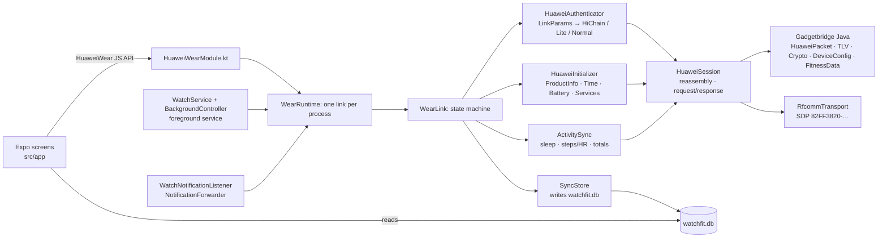

# WatchFit

WatchFit is an Android companion app for the **Huawei Watch Fit 4 / Fit 4 Pro**. It has no Huawei
Health install, no account and no cloud: data goes from the watch to the phone into a local SQLite
database and stays there.

The app has two parts:

- an Expo (SDK 57) React Native app for the screens;
- `modules/huawei-wear`, a local Expo module that implements the watch's protocol. It is a port of
  [Gadgetbridge](https://codeberg.org/Freeyourgadget/Gadgetbridge)'s Huawei support.

## How it talks to the watch

The Fit 4 uses **Bluetooth Classic RFCOMM**, not BLE GATT. This is why the earlier BLE explorer
never found a usable channel. See [`protocol/README.md`](protocol/README.md) for the frame format,
the commands used, and how the app picks an auth path.



## What works

| Feature | Status |
|---|---|
| Bonded-device list, connect, disconnect | implemented |
| Auth: HiChain (first bind with on-watch confirmation, then reconnect), HiChain Lite, normal | implemented (ported from GB) |
| Product info, time sync, battery | implemented |
| Sync per-minute steps / kcal / distance / HR / SpO₂ / resting HR, sleep segments, today's totals | implemented |
| Local storage + Today screen + raw packet log (copy to clipboard) | implemented |
| Sleep stages from TruSleep / dictionary files (file download services 0x2C and 0x0A) | implemented, gated like GB; unverified on the Fit 4 |
| Background mode: foreground service keeps the watch connected, reconnects with backoff, syncs every 30 min (configurable), starts on boot | implemented; unverified on the Fit 4 |
| Notification forwarding (app name, title, text) with a per-app list | implemented; unverified on the Fit 4 |
| Profile (height, weight, birth year, sex) and daily step goal sent to the watch | implemented; unverified on the Fit 4 |
| Calls, workouts with GPS | not implemented |

The protocol layer is covered by the Gadgetbridge packet, TLV and crypto tests plus our own
session reassembly tests, 120 JVM tests in total. **It has not yet been run against a real Fit 4.**
The first connect is the real test. When you do it, save the Log tab (Copy) and add the
link parameters to `protocol/README.md` → Observations.

## Using it

1. Unbind the watch from Huawei Health. The watch can only be bound to one app at a time; a
   factory reset of the watch also works.
2. Pair the watch in **Android Settings → Bluetooth**. It shows up as `HUAWEI WATCH FIT 4-XXX`.
3. Open WatchFit → **Device** → grant Nearby devices → tap the watch → **Connect**.
   - On the first connect, confirm the pairing on the watch within 30 s.
4. Go to **Today** and tap **Sync**. The first sync pulls the last 7 days. Each later sync starts
   from the previous one, with 1 h of overlap.
5. **Settings** has the background toggle and sync interval, notification forwarding, and your
   profile and step goal. The watch you last connected from **Device** is the one background mode follows.
6. **Log** shows every TX/RX frame in hex.

### Background mode

Turn on **Keep connected in the background** in Settings. A foreground service (type
`connectedDevice`, with a low-priority notification) owns the one watch link: it connects when it
starts, reconnects after a drop (5 s, doubling up to 5 min; at once when Bluetooth turns on or the
watch's ACL link comes up), and syncs and reads the battery on a timer. After a reboot it starts again.
Sync results are written to the database by native code, so data accumulates while the app is closed.

- The first bind still has to be confirmed on the watch from the Device tab; the service never starts a bind.
- Tapping **Disconnect** in the app pauses auto-reconnect until you connect again.
- Android 13+ asks for the notification permission when you enable it. Without it the service still
  runs but its notification is hidden.
- Battery optimisation: if your phone kills the service, exempt WatchFit from battery restrictions.

### Notifications

In Settings, grant **notification access** (on Android 13+ a sideloaded app must first be allowed
under App info → ⋮ → *Allow restricted settings*), then switch on forwarding. Ongoing notifications,
group summaries, local-only ones, calls, media controls, progress bars and WatchFit's own are skipped.
Apps you have not chosen are on, except system apps; **Choose apps** overrides either way.
Notifications only reach the watch while it is connected, so use background mode to keep it connected.

## Permissions

| Permission | Why |
|---|---|
| `BLUETOOTH_CONNECT` (`BLUETOOTH` / `BLUETOOTH_ADMIN` up to API 30) | list bonded watches and open the RFCOMM link |
| `FOREGROUND_SERVICE`, `FOREGROUND_SERVICE_CONNECTED_DEVICE` | the background service (Android 14 requires the typed permission) |
| `POST_NOTIFICATIONS` | show the service notification (runtime prompt on Android 13+) |
| `RECEIVE_BOOT_COMPLETED` | restart background mode after a reboot or app update |
| `WAKE_LOCK` | keep the CPU awake while a reconnect or sync runs in the background |
| Notification access (special, granted in Android settings) | read posted notifications to forward them |

There is no internet use and no `QUERY_ALL_PACKAGES`: the app chooser lists launcher apps through a
`<queries>` entry.

## Where data lives

`watchfit.db` in `<app files>/SQLite` is shared by the screens (expo-sqlite, read) and the native
module (`android.database.sqlite`, write, WAL with a 10 s busy timeout). The schema is one JSON file,
`modules/huawei-wear/schema/watchfit-db-migrations.json`, imported by `src/db/migrations.ts` and shipped
as an Android asset that the native side migrates from, so JS and native cannot drift. Native
upserts the same rows the JS queries used to, and advances `device.last_sync` in the same transaction.
The profile, background and notification settings are in native SharedPreferences (`watchfit_settings`).

**Forget pairing** deletes the stored auth key. The next connect then does a fresh bind.

## Build

Requirements: bun, JDK 17, and an Android SDK (platform 36). A physical Android 10+ phone is needed
for Bluetooth; emulators can't reach the watch.

```bash
bun install
bunx expo prebuild -p android          # generates android/ (gitignored, CNG)
bun run android                        # expo run:android: build, install, start Metro
bun run test:native                    # JVM tests for the protocol + session layers
bun run typecheck && bun run lint
```

Keep `JAVA_HOME` pointed at JDK 17 and `ANDROID_HOME` at the SDK.

## Layout

```
src/app/                  expo-router tabs: index (Device), today, settings, log
src/state/                WatchProvider (link state, events), log ring buffer
src/db/                   expo-sqlite migrations (from the shared JSON) + read queries
src/features/             screen pieces (device, today, settings, log)
modules/huawei-wear/
  src/                    TS contract (HuaweiWear.types.ts, HuaweiWearModule.ts)
  schema/                 watchfit-db-migrations.json, read by JS and by native
  android/src/main/java/
    com/joyodigitama/huaweiwear/            Kotlin: transport, session, auth, init, sync, runtime/service, notifications, Expo module
    nodomain/freeyourgadget/gadgetbridge/   Gadgetbridge Java, upstream package names kept for diffing
  android/src/test/java/                    Gadgetbridge tests + HuaweiSessionTest
protocol/README.md        protocol reference + observations
```

## Updating from Gadgetbridge

The ported Java keeps GB's package names and file layout. Each modified file has a
`Modified for watch-fit` header line. To pull in upstream fixes, diff these files against GB.
The upstream base is recorded in [`NOTICE`](NOTICE).

## License

[AGPL-3.0-or-later](LICENSE). The project is derived from Gadgetbridge; see [`NOTICE`](NOTICE).
If you distribute this app, or modified versions of it, you must provide the source.
