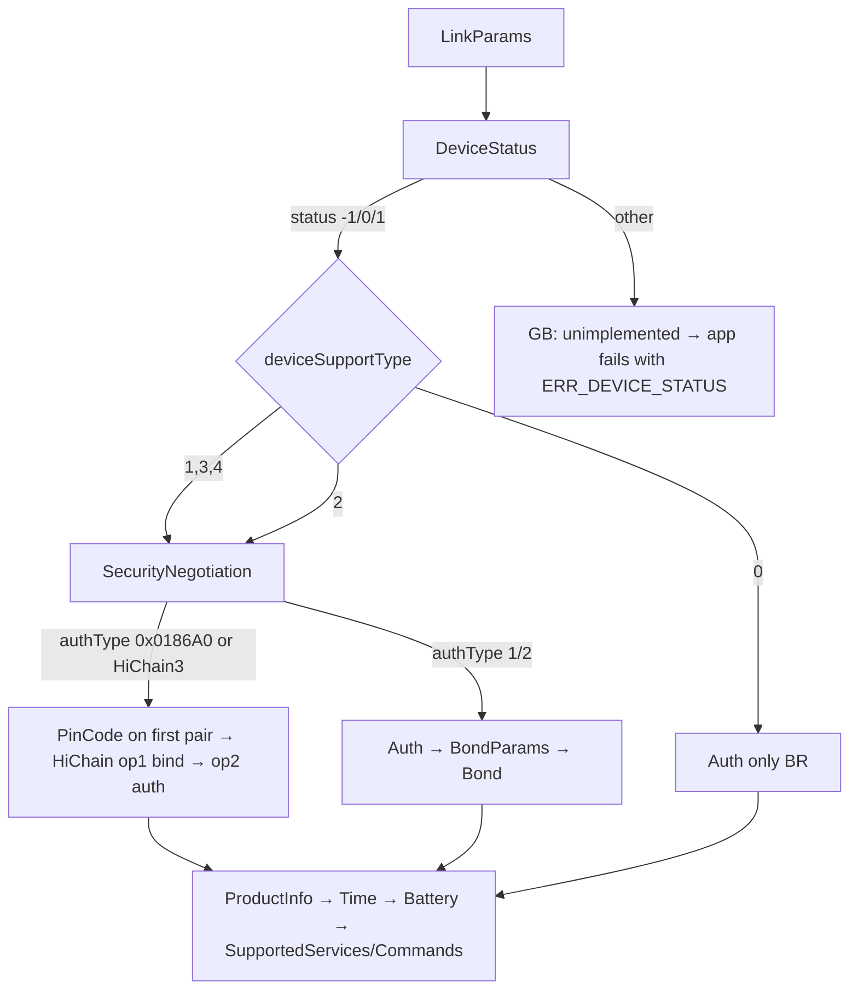

# Huawei link protocol: what this app uses

These notes come from Gadgetbridge (upstream `bb7a1e83`, 2026-10-13). Nothing here has been
captured from our own watch yet. Gadgetbridge lists the Watch Fit 4 and Fit 4 Pro as supported
devices (`HuaweiJoyoFit4ProCoordinator`). When a capture from a real watch confirms or contradicts
something below, note it under **Observations**.

## Transport

| Item | Value | GB source |
|---|---|---|
| Link | Bluetooth Classic (BR/EDR) RFCOMM, **not BLE GATT** | `HuaweiBRCoordinator.getConnectionType() = BT_CLASSIC` |
| SDP service UUID | `82FF3820-8411-400C-B85A-55BDB32CF060` | `HuaweiConstants.UUID_SERVICE_HUAWEI_SDP` |
| Socket | `createRfcommSocketToServiceRecord` (secure, needs a bond) | `btbr/BtBRQueue.connect` |
| Advertised name | `HUAWEI WATCH FIT 4-XXX` / `HUAWEI WATCH FIT 4 Pro-XXX` | `HuaweiConstants.HU_JOYOFIT4*_NAME` |

The BLE service `0xFE86` (`FE01` write / `FE02` notify) is how older BLE-only Huawei bands connect.
The Fit 4 is a BR device, so that service doesn't apply to it. This is why the old GATT explorer
never found a usable channel.

## Frame

```
5A | len:u16 BE | slice:u8 | [flag:u8 if sliced] | service:u8 | command:u8 | TLV… | CRC16:u16 BE
```

- Unsliced frames: `slice = 0x00` and `len = 1 + 2 + |TLV|`.
- Sliced frames: `slice` goes 01, 02, …, 03 (last). `flag` is a counter, and service/command
  appear only in the first slice.
- The CRC16 covers everything from `5A` up to the CRC field (`CheckSums.getCRC16(…, 0)`).
- Payloads use nested TLV with varint lengths (`HuaweiTLV`). Tags with bit 7 set are containers.
- After auth, TLVs are encrypted with AES-CBC or AES-GCM, chosen by `encryptMethod`. Encrypted
  TLVs use tags `0x7C/0x7D/0x7E` (`HuaweiTLV.encrypt`).

## Commands used by the app

| Service | Cmd | Name | Purpose |
|---|---|---|---|
| `01` DeviceConfig | `01` | LinkParams | protocol version, slice size, MTU, server nonce, auth version/algo, `deviceSupportType`, encrypt method |
| `01` | `16` | DeviceStatus | decides whether a HiChain bind is needed |
| `01` | `33` | SecurityNegotiation | returns `authType` (HiChain vs HiChain Lite) |
| `01` | `2C` | PinCode | the watch supplies the PIN used by HiChain on first pairing |
| `01` | `28` | HiChain | 4-step ISO exchange: op 1 = bind, op 2 = auth; HKDF-SHA256 session key |
| `01` | `13` | Auth | HMAC challenge/response (normal and HiChain Lite modes) |
| `01` | `0F` / `0E` | BondParams / Bond | sends the encrypted bonding key (HiChain Lite / BLE) |
| `01` | `07` | ProductInfo | model, firmware, hardware, serial |
| `01` | `05` | TimeRequest | read/set watch time |
| `01` | `08` | BatteryLevel | battery % |
| `01` | `02` / `03` | SupportedServices / SupportedCommands | capability discovery |
| `07` FitnessData | `0C` / `0D` | sleep MessageCount / MessageData | sleep segments `(start, minutes, type)` |
| `07` | `0A` / `0B` | step MessageCount / MessageData | per-minute steps / kcal / distance / HR / SpO₂ / resting HR |
| `07` | `03` | FitnessTotals | today's totals |
| `07` | `02` | UserInfo | height, weight, age, birthday, gender, walk/run step lengths; sent in init when the profile was saved |
| `07` | `01` | MotionGoal | daily step goal (goal type 1); the calorie and duration goals are not sent |
| `02` Notifications | `05` | NotificationCapabilities | only asked when `supportsPromptPushMessage` and protocol version 2 (GB default capability byte `0xFF` skips it) |
| `02` | `02` | NotificationConstraints | content format and maximum content length; asked when `02/01` is supported and protocol version is 2 |
| `02` | `04` | NotificationState | the watch-side notification switch (`0x81{02:on,03:on}`); sent in init and when forwarding is toggled, if `02/04` is supported |
| `02` | `01` | NotificationAction | one notification: id, type (`7F` generic, `0F` email), title/sender/text elements, source package, optional key/channel/category/timestamp tags by ExpandCapability |
| `02` | `06` | NotificationRemoveAction | dismisses one notification on the watch; only when ExpandCapability 94 or 120 is set |
| `0B` FindPhone | `01` (watch → phone) | start / stop find phone | tag `01` bool: true = start; a missing tag means stop |
| `0B` | `02` | StopFindPhone | `01` = 2, sent whenever the phone's alert ends |
| `37` DataSync | `01` | ConfigCommand | find my watch: `01` = `hw.unitedevice.finddevice`, `02` = `findDevice`, `83{84{05 = 900100002, 06 = 2 start / 1 stop}}`; gated by ExpandCapability 79 (find device) and 83 (config commands) |
| `04` Calls | `01` (watch → phone) | AnswerCall | tag `01` byte: 1 = reject, 2 = accept |
| `08` Alarms | `01` | EventAlarms | set: `81{82{03 index 1-5, 04 on, 05 hour<<8 \| minute, 06 repeat, 07 name}…}`; an empty list sends a bare `82{03 = 1}` |
| `08` | `02` / `03` / `04` | SmartAlarm / EventAlarmList / SmartAlarmList | set smart (`03` = 1, `04`, `05`, `06`, `07` = minutes early) / read the event alarms / read the smart alarm; list gated by SupportedCommands `08/03`, smart by `08/02` |
| `2C` FileDownload | `01` init, `03` info, `04` block request, `05` data (pushed), `06` complete | new-sync file download | `sequence_data` (sleep dictionary 700013), `sleep_state.bin`, `sleep_data.bin` |
| `0A` FileDownload | `01` init, `02` parameters, `03` info, `04` block request, `05` data (pushed), `06` complete | old-sync file download | `sleep_state.bin` / `sleep_data.bin` when SettingRelated `truSleepNewSync` is false |
| `17` Workout | `07` count, `08` totals, `0A` data, `0C` pace, `0E` swim segments, `14` SpO₂, `16` sections, `15` capability | workout sync | workouts, heart-rate series, pace splits; see Workouts and GPS |
| `2C` / `0A` | as above | GPS file | `<n>_gps.bin` for a workout (file type `0x11`; `0A`: init type `02`, FileParameters type `02`) |
| `0F` Weather | `09` start, `05` unit, `02` support, `06` extended support, `0A` sun/moon support, `01` current, `08` forecast, `07` / `0C` error, `04` device request | weather push | see Weather |
| `18` GpsAndTime | `07` | current position | sent after the current weather when `18/06` is listed; see Weather |
| `27` Watchface | `01` params, `02` list, `06` names, `03` operation, `05` confirm (pushed) | watch faces | list, set active, delete, install confirmation; see Watch faces |
| `28` FileUpload | `02` info, `03` hash, `04` ack, `05` chunk request (pushed), `06` chunk, `07` result, `08` error (pushed) | watch face upload | the watch drives, the phone answers; see Watch faces |

## Notifications and profile

The app forwards a phone notification with `02/01` when SupportedCommands lists it (GB
`supportsNotificationAlert`). Text elements: type `03` title (the app name when the notification has
none), `02` sender (the app name; GB leaves it empty for non-SMS), `01` text. A text longer than the
watch's content length is cut to `length - 13` characters plus `...`. ExpandCapability bits that add tags:
73 reply actions, 77 timestamp (`0x15`), 89 reply key (`0x18`), 94 repeated notify and 120 remove single
(`0x19` key, `0x1A` id, `0x1B` channel), 256 pictures (not used). Notifications are not acknowledged
by anything we parse; a missing ack is only logged.

Init appends, after `ConnectStatus` and in GB order: UserInfo `07/02` and MotionGoal `07/01` (only if
the user saved a profile; each only if the watch lists the command), NotificationCapabilities,
NotificationConstraints, NotificationState. UserInfo carries the optional gender-unknown (ExpandCapability
`0x57`) and precision-weight (`0xB3`, weight × 100 in tag `0x0B`) fields. VO2 max is never sent.

## Sleep files (TruSleep / dictionary)

After the frame-based sync, `SleepSync` follows GB's `downloadTruSleepData(start, end)`:

1. Nothing unless SupportedCommands lists FitnessData `07` command `16` (`supportsTruSleep`).
2. ExpandCapability bit 143 (`supportsDictSleepSync`): download `sequence_data` for dictionary class
   700013 over service `2C`, parse it with `HuaweiSequenceDataFileParser` and
   `HuaweiTrueSleepSequenceDataParser` into one-minute stages (watch stage 1 light, 2 REM,
   3 deep, 4 awake, 5 nap), merged into segments. GB does not fall back to the state/data files when this fails.
3. Otherwise `sleep_state.bin` and `sleep_data.bin` (service `2C` if SettingRelated tag `02` bit 1 is set,
   else `0A`). Each 16-byte record of the state file is a `(start, end)` sleep range, stored by GB as one
   light-sleep span (raw kind `06`). GB does not interpret `sleep_data.bin`; the app only parses it for the log.

GB's P2P data-dictionary sync (`34`/`01`, module `hw.unitedevice.datadictionarysync`) carries skin
temperature, HRV, emotion, sleep apnea and similar. It carries no sleep stages, steps, heart rate
or SpO₂, so it is not ported.

## Workouts and GPS

`WorkoutSync` follows GB's `HuaweiWorkoutSyncManager` after the activity sync, over service `17`:

1. Skipped when SupportedCommands is known and has no service `17`. `17/15` WorkoutCapability (only if listed)
   returns `supportNewStep` (bit 1 of tag `01`), which adds tag `06` to the data request and changes the walking cadence.
2. `17/07` WorkoutCount for `[start, end]`: per workout a number, the counts of data, pace, swim-segment, SpO₂ and
   section chunks, and `trajectoriesData` (tag `0E`, 1 when a `_gps.bin`/`_pdr.bin` exists). `start` is the end of the
   newest stored workout + 1 (2022-06-10 when none; the oldest incomplete workout wins). An error answer or a count that
   does not match the list splits the window in halves, up to 5 levels (GB).
3. Per workout, in number order: `17/08` totals (start, end, calories, distance m, steps, total and active seconds,
   sport type byte, altitude and elevation in dm, heart-rate peaks, training load, recovery time, swim and run-pace
   fields), `17/0A` data chunks (header: workout, chunk, timestamp, interval, count, length, bitmap; per sample heart rate,
   speed dm/s, step rate, swolf, stroke rate, altitude dm, an inner block of running/cycling metrics, calories, jump
   frequency, cycling power), `17/0C` pace blocks (per km `type 0` / per mile `type 1`, seconds per unit, last block a
   fraction in 1/10000), `17/0E` swim segments, `17/14` SpO₂, `17/16` sections.
4. Each request that answers with an error (tag `7F`), a wrong workout/chunk number or no usable TLV is repeated 3 times,
   then skipped and the workout is marked `missingData`. Section error `0001E079` is ignored (GB: normal). A timeout
   aborts the sync and stores the workout as incomplete (GB aborts without storing).
5. GPS: file `<n>_gps.bin` (file type `0x11`, start/end 0) over `2C` when SettingRelated tag `02` bit 3 is set
   (`gpsNewSync`); otherwise the `0A` init with `02{02:02, 86{07:01, 88{09:workout}}}` answers with the workout's file list
   (`8B/8C/0D`, `;` separated), the `_gps.bin` entry is downloaded with FileParameters type `02`. Skipped when the watch
   sent `trajectoriesData = 0`. A failed GPS download does not make the workout incomplete.

Sport type bytes map to GB's `HuaweiActivityType` names (`WorkoutSportTypes.kt`, 107 types; unknown ones are shown as
`Workout (type N)`). GPS file layout (`HuaweiGpsParser`, little endian): 0x20 trim bytes, a type byte (`& 3 == 3` means
altitude is present), start time, longitude, latitude (degrees, plus altitude), padding up to offset 62 / 70, then
15 / 19-byte records `(time delta s, ?, lon delta f32, lat delta f32, ?, ?, pause[, altitude i16, ?])`. GB's loop
leaves out a final record that would end exactly at the end of the file.

## Weather

Port of GB's `HuaweiWeatherManager.sendWeather` (`Weather.java`, `SendWeather*Request`). The watch only
takes it if it lists `0f/01` in SupportedCommands (`supportsWeather`); every request below waits for the
watch's reply with the same service and command (5 s), like GB's request chain. All TLVs are encrypted.

| Step | Command | Sent when | Content |
|---|---|---|---|
| 1 | `0f/09` WeatherStart | always | `01: 03`. The reply's tag `7f` must be `0x186A0` or `0x186A3`, else GB stops the chain and so do we |
| 2 | `0f/05` WeatherUnit | `0f/05` listed | `01:` 0 = °C, 1 = °F |
| 3 | `0f/02` WeatherSupport | always | `01:`; reply bitmap: bit0 weather, 1 wind, 2 pm2.5, 3 temperature, 4 location name, 5 current temperature, 6 unit, 7 air quality |
| 4 | `0f/06` WeatherExtendedSupport | `0f/06` listed | reply bitmap: bit0 time, 1 source, 2 icon |
| 5 | `0f/0a` WeatherSunMoonSupport | `0f/0a` listed | reply bitmap: bit0 sun rise/set, 1 moon phase |
| 6 | `0f/01` Current | always | `81{02 icon, 03 wind = (direction << 8) + beaufort}`, `85{06 low, 07 high}`, `04` pm2.5, `08` location, `09` current temp, `0a` unit, `0b` AQI, `0c` observation time, `0e` source, `0f` UV (ExpandCapability 0x2f), `10` humidity, `11` wind km/h, `12` feels-like (ExpandCapability 0xc0) |
| 7 | `18/07` GpsAndTime | `18/06` listed | `01` time (now - 1 day, as GB), `02` lat f64, `03` lon f64 (7 decimals); a missing reply is only logged |
| 8 | `0f/08` Forecast (sliced) | `0f/08` listed | `81{82{03 time, 04 icon, 05 temp, 06 rain %, 07 UV}}` up to 24 hours; `90{91{12 time, 13 icon, 14 high, 15 low, 16/17 sun rise/set, 1a/1b moon rise/set, 1e moon phase}}` up to 8 days (today first). Each tag only if the matching support bit is set |

A tag the watch did not report as supported is left out. Temperatures are whole degrees Celsius in a signed byte in
every unit (GB sends `K - 273` and sets the unit tag only); whether the watch converts for display is not verified.
Today's entry uses the current icon and the observation time, later days use the observation time plus whole days
(GB's `SendWeatherForecastRequest`). Sun times outside their local day are sent as 0 (GB `fixupWeather`: a wrong one makes
the watch show no weather at all). Open-Meteo has no moon rise/set (sent as 0, which the packet skips) so only
the moon phase is sent, computed from the synodic month ([0..360) degrees to GB's eight phases).

Errors (`0f/0c` WeatherErrorExtended when listed, else `0f/07` WeatherErrorSimple): `0` network, `1` GPS permission
(used for no location available), `2` weather disabled.

**Watch request.** The watch sends `0f/04` with tag `7f` = `0x000186AA` to ask for weather. We answer with the push above
(or the matching error). Any other `0f/04` is acknowledged with `0f/04` `01: 0x186A0`, unencrypted, without waiting for a reply
(GB `handleAsyncMessage`). A request inside five minutes of the last fetch reuses that data.

**Icons.** Open-Meteo gives WMO codes. GB has no WMO table, only OpenWeatherMap code to Huawei icon
(`openWeatherMapConditionCodeToHuaweiIcon`, ported unchanged), so WMO goes through the closest OpenWeatherMap code
(table in `WeatherModel.kt`): 0 sunny; 1 and 2 cloudy; 3 overcast; 45 and 48 fog; 51 to 55 drizzle, 61 and 80 light rain, 63 and 81 rain,
65 and 82 heavy rain; 56, 57, 66, 67 freezing rain; 71, 77, 85 light snow, 73 snow, 75 and 86 heavy snow; 95 to 99
thunderstorm. Icon byte values are in `Weather.java` (`iconToByte`, unknown = `0x63`).

## Find phone, find watch, calls and alarms

- **Find phone** (watch → phone): `0B/01` arrives unrequested. GB ignores it unless its find-phone setting is on, then
  rings (alarm stream at maximum volume, vibration, notification). When the alert ends for any reason, including the
  watch's own stop, GB sends `0B/02` (`01` = 2). We do the same and never answer the start.
- **Find watch**: GB's `HuaweiDataSyncFindDevice`, a DataSync config command (service `37`, command `01`), not a
  FindPhone packet. Request only; GB does not wait for a reply, and replies and watch-side events are only logged
  (`DataSync config from ... id=900100002 action=...`; GB notes actions 2 and 4).
- **Calls**: an incoming call is a normal notification `02/01` with type `01` (call): text element `01` = caller name
  (number if unknown), and element `07` = number in the format the watch reported (`incomingNumberFormat`) when it
  supports incoming numbers (NotificationConstraints). Answering on the phone sends the same packet with type `0D`
  (start call, ExpandCapability 74) or `0C` (stop) and an empty text; the end of the call sends `0C`. Those two are
  not acknowledged. The watch's buttons come back as `04/01` (1 reject, 2 accept).
- **Alarms** (service `08`): event alarms use watch index 1 to 5 (the smart alarm is separate, index 1 of `08/02`). A
  slot missing from the list is not an alarm, and a set replaces the whole event list. The app sends the list, then
  reads it back, because a missing acknowledgment is otherwise invisible.

## Watch faces

Port of GB's `HuaweiWatchfaceManager`, `HuaweiUploadManager`, `HuaweiFwHelper.parseAsWatchFace`, the watch face branch of
`HuaweiInstallHandler` and the `0x27` / `0x28` packet classes (`Watchface.java`, `FileUpload.java`). Everything on the
watch face list is TLV-encrypted like the other services.

| Service | Cmd | Name | Content |
|---|---|---|---|
| `27` Watchface | `01` | WatchfaceParams | request tags `01..05, 0e, 0f` empty; reply `01` max version, `02` width, `03` height, `04` supported file type, `05` sort, `06` other versions. Gated by SupportedCommands `27/01` (`supportsWatchfaceParams`); we log `width` and `height` |
| `27` | `02` | DeviceWatchInfo | request `06 = 3`; reply `81{82{03 id, 04 version, 05 type bits, 07 expanded type}…}`. Type bits: 0 current, 1 factory, 3 editable, 4 video, 5 photo, 6 trial, 7 kaleidoscope |
| `27` | `06` | WatchfaceNameInfo | request `01 = 1, 82{83{04 id}…}`; reply `82{83{04 id, 05 name}…}` |
| `27` | `03` | WatchfaceOperation | `01` id, `02` version, `03` operation: 1 = make active, 2 = delete. GB does not parse the reply; we read an optional `7f` status and log it |
| `27` | `05` | WatchfaceConfirm | watch → phone after an upload: `01` id, `02` version, `03` report type. We answer `01`, `02`, `7f = 0x186A0`; report type 2 makes GB send operation 1 (activate) for the new face |
| `28` FileUpload | `02` | FileInfoSend | `01` name `<id>_<version>`, `02` size, `03` file type (1 watch face, 2 music, 3 background image, 6 app, 7 firmware), watch faces also `05` id and `06` version. Reply `7f`: `100000` = accepted |
| `28` | `03` | FileHashSend | watch asks (`01` file id), phone answers `01` file id, `03` SHA-256 of the data |
| `28` | `04` | FileUploadConsultAck | watch sends `01` file id, `02` protocol, `03` app wait time, `04` bitmap enable, `05` unit size, `06` max apply data size, `07` interval, `08` received size, optional `09` no-encrypt; phone answers `7f = 0x186A0`, `01` file id, and `09 = 1` when the watch said no-encrypt |
| `28` | `05` | FileNextChunkParams | watch asks for data: `02` bytes uploaded, `03` next chunk size |
| `28` | `06` | FileNextChunkSend | phone → watch, not TLV: per `unit size` packet `fileId, index, position (u32 BE), data`, the whole payload wrapped in the encryption TLV unless the watch said no-encrypt; sliced like any frame |
| `28` | `07` | FileUploadResult | watch announces the end (`02` status, not interpreted by GB); phone answers `7f = 0x186A0`, `01` file id |
| `28` | `08` | FileUploadDeviceResponse | watch → phone error report: `01` file id, `7f` code; GB ends the upload when the id is the current one |

**Install flow** (`WatchfaceOps.install`, `FileUploader`): the phone sends `28/02`; then the watch drives, and every packet it
sends reaches the uploader through `HuaweiSession.subscribe`: `28/02` result, `28/03` hash request, `28/04` parameters,
`28/05` chunk requests (answered with `28/06` of exactly the bytes asked for, cut into `unit size` packets; a request past the
end of the file is clamped), `28/07` result, then `27/05`. Each watch message has to follow within 60 s of the previous one.
Chunk packets are logged as one summary line, not as hex per frame.

**Package.** A `.hwt` is a zip with `description.xml` (root `HwTheme`, or `HnTheme` for Honor), `preview/cover.jpg` and
`com.huawei.watchface` (`com.honor.watchface`), itself a zip with `watchface.bin` (older packages: the binary directly). Only the
`watchface.bin` is uploaded, as file type 1, under the name `<nine random digits>_1.0.0` (GB `getRandomName`). The `screen` of
`description.xml` is a theme version code; GB's table maps it to `height*width`, and the install is refused when it does not equal
the watch's `WatchfaceParams` height and width. The table is ported unchanged; a code it does not know is let through and left
to the watch.

**Screen.** Huawei lists the Watch Fit 4 and Fit 4 Pro with a 1.82 inch AMOLED of 480 x 408 px. In GB's table that is
`HWHD13` = `480*408` (height 480, width 408); Theme Studio Pro calls the same size "408 x 480". The `WatchfaceParams` width and
height of the watch are written to the Log tab (`Watchface: WatchfaceParams: width=… height=…`), and the answer is the thing to
compare this table against.

**Errors.** `28/02` answers other than `100000` and `28/08` reports end the upload with the code the watch sent. GB names three:
`140004` too many watch faces or music files, `140008` file already exists, `140009` not enough space. Every other code is shown
and logged as it came. After the transfer the phone reads the watch face list: a face that is not in it afterwards is reported
as "not listed" (`listed: false`), which is how a face dropped after verification would show. Whether the Fit 4 accepts faces that
Huawei did not sign is **not known**; see Observations once someone has tried one.

## Auth decision



The watch can only be bound to one phone app at a time. Binding it to this app replaces its
binding to Huawei Health, and the reverse is also true.

## Observations

### 2026-10-14: first connect, Watch Fit 4 (SYA-B29, `Seiya-B29F`), firmware 6.1.0.117(SP20C00M05)

Phone: Xiaomi 15T Pro (Android). The watch had been unbound from Huawei Health and then paired
in Android Bluetooth settings.

- RFCOMM via SDP UUID connected in about 0.2 s.
- LinkParams: protocolVersion `0x02`, deviceSupportType `0x04`, authVersion `0x01`,
  authAlgo `0x00`, encryptMethod `0x00` (AES-CBC), bondState `0x00`, MTU 990, sliceSize 1022.
- DeviceStatus returned `0x01`, so the HiChain path was taken.
- SecurityNegotiation returned authType `5` → **HiChain3**.
- First-pair sequence: PinCode, then HiChain op1 steps 1–4, then op2 steps 1–3. Every token and
  MAC check passed, and the whole exchange took about 0.6 s. The watch's PIN came over the link
  (no typed PIN needed).
- After auth the TLVs are encrypted (tags `7C/7D`). ProductInfo, SetTime (drift 1 s), Battery
  (71 %) and SupportedServices all decrypted and parsed.
- SupportedServices: `01 02 04 07 08 09 0a 0b 0c 0f 14 16 17 18 19 1a 1b 20 25 27 2a 2b 2e 30
  32 34 35`. `07` (FitnessData) is present.

So Gadgetbridge's HiChain3 path works unchanged on the Fit 4.
