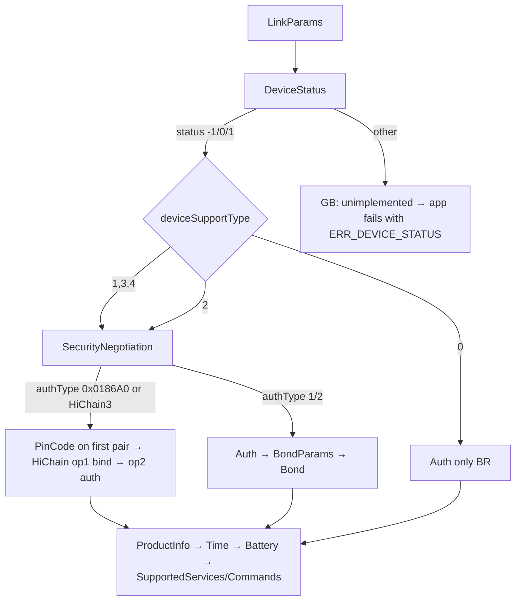

# Huawei link protocol: what this app uses

These notes come from Gadgetbridge (upstream `bb7a1e83`, 2026-10-13). Nothing here has been
captured from our own watch yet. Gadgetbridge lists the Watch Fit 4 and Fit 4 Pro as supported
devices (`HuaweiWatchFit4ProCoordinator`). When a capture from a real watch confirms or contradicts
something below, note it under **Observations**.

## Transport

| Item | Value | GB source |
|---|---|---|
| Link | Bluetooth Classic (BR/EDR) RFCOMM, **not BLE GATT** | `HuaweiBRCoordinator.getConnectionType() = BT_CLASSIC` |
| SDP service UUID | `82FF3820-8411-400C-B85A-55BDB32CF060` | `HuaweiConstants.UUID_SERVICE_HUAWEI_SDP` |
| Socket | `createRfcommSocketToServiceRecord` (secure, needs a bond) | `btbr/BtBRQueue.connect` |
| Advertised name | `HUAWEI WATCH FIT 4-XXX` / `HUAWEI WATCH FIT 4 Pro-XXX` | `HuaweiConstants.HU_WATCHFIT4*_NAME` |

The BLE service `0xFE86` (`FE01` write / `FE02` notify) is how older BLE-only Huawei bands connect.
The Fit 4 is a BR device, so that service doesn't apply to it. This is why the old GATT explorer
never found a usable channel.

## Frame

```
5A | len:u16 BE | slice:u8 | [flag:u8 if sliced] | service:u8 | command:u8 | TLV… | CRC16:u16 BE
```

- Unsliced frames: `slice = 0x00` and `len = 1 + 2 + |TLV|`.
- Sliced frames: `slice` goes 01, 02, …, 03 (last). `flag` is a counter, and service/command
  appear only in the first slice.
- The CRC16 covers everything from `5A` up to the CRC field (`CheckSums.getCRC16(…, 0)`).
- Payloads use nested TLV with varint lengths (`HuaweiTLV`). Tags with bit 7 set are containers.
- After auth, TLVs are encrypted with AES-CBC or AES-GCM, chosen by `encryptMethod`. Encrypted
  TLVs use tags `0x7C/0x7D/0x7E` (`HuaweiTLV.encrypt`).

## Commands used by the app

| Service | Cmd | Name | Purpose |
|---|---|---|---|
| `01` DeviceConfig | `01` | LinkParams | protocol version, slice size, MTU, server nonce, auth version/algo, `deviceSupportType`, encrypt method |
| `01` | `16` | DeviceStatus | decides whether a HiChain bind is needed |
| `01` | `33` | SecurityNegotiation | returns `authType` (HiChain vs HiChain Lite) |
| `01` | `2C` | PinCode | the watch supplies the PIN used by HiChain on first pairing |
| `01` | `28` | HiChain | 4-step ISO exchange: op 1 = bind, op 2 = auth; HKDF-SHA256 session key |
| `01` | `13` | Auth | HMAC challenge/response (normal and HiChain Lite modes) |
| `01` | `0F` / `0E` | BondParams / Bond | sends the encrypted bonding key (HiChain Lite / BLE) |
| `01` | `07` | ProductInfo | model, firmware, hardware, serial |
| `01` | `05` | TimeRequest | read/set watch time |
| `01` | `08` | BatteryLevel | battery % |
| `01` | `02` / `03` | SupportedServices / SupportedCommands | capability discovery |
| `07` FitnessData | `0C` / `0D` | sleep MessageCount / MessageData | sleep segments `(start, minutes, type)` |
| `07` | `0A` / `0B` | step MessageCount / MessageData | per-minute steps / kcal / distance / HR / SpO₂ / resting HR |
| `07` | `03` | FitnessTotals | today's totals |
| `07` | `02` | UserInfo | height, weight, age, birthday, gender, walk/run step lengths; sent in init when the profile was saved |
| `07` | `01` | MotionGoal | daily step goal (goal type 1); the calorie and duration goals are not sent |
| `02` Notifications | `05` | NotificationCapabilities | only asked when `supportsPromptPushMessage` and protocol version 2 (GB default capability byte `0xFF` skips it) |
| `02` | `02` | NotificationConstraints | content format and maximum content length; asked when `02/01` is supported and protocol version is 2 |
| `02` | `04` | NotificationState | the watch-side notification switch (`0x81{02:on,03:on}`); sent in init and when forwarding is toggled, if `02/04` is supported |
| `02` | `01` | NotificationAction | one notification: id, type (`7F` generic, `0F` email), title/sender/text elements, source package, optional key/channel/category/timestamp tags by ExpandCapability |
| `02` | `06` | NotificationRemoveAction | dismisses one notification on the watch; only when ExpandCapability 94 or 120 is set |
| `2C` FileDownload | `01` init, `03` info, `04` block request, `05` data (pushed), `06` complete | new-sync file download | `sequence_data` (sleep dictionary 700013), `sleep_state.bin`, `sleep_data.bin` |
| `0A` FileDownload | `01` init, `02` parameters, `03` info, `04` block request, `05` data (pushed), `06` complete | old-sync file download | `sleep_state.bin` / `sleep_data.bin` when SettingRelated `truSleepNewSync` is false |

## Notifications and profile

The app forwards a phone notification with `02/01` when SupportedCommands lists it (GB
`supportsNotificationAlert`). Text elements: type `03` title (the app name when the notification has
none), `02` sender (the app name; GB leaves it empty for non-SMS), `01` text. A text longer than the
watch's content length is cut to `length - 13` characters plus `...`. ExpandCapability bits that add tags:
73 reply actions, 77 timestamp (`0x15`), 89 reply key (`0x18`), 94 repeated notify and 120 remove single
(`0x19` key, `0x1A` id, `0x1B` channel), 256 pictures (not used). Notifications are not acknowledged
by anything we parse; a missing ack is only logged.

Init appends, after `ConnectStatus` and in GB order: UserInfo `07/02` and MotionGoal `07/01` (only if
the user saved a profile; each only if the watch lists the command), NotificationCapabilities,
NotificationConstraints, NotificationState. UserInfo carries the optional gender-unknown (ExpandCapability
`0x57`) and precision-weight (`0xB3`, weight × 100 in tag `0x0B`) fields. VO2 max is never sent.

## Sleep files (TruSleep / dictionary)

After the frame-based sync, `SleepSync` follows GB's `downloadTruSleepData(start, end)`:

1. Nothing unless SupportedCommands lists FitnessData `07` command `16` (`supportsTruSleep`).
2. ExpandCapability bit 143 (`supportsDictSleepSync`): download `sequence_data` for dictionary class
   700013 over service `2C`, parse it with `HuaweiSequenceDataFileParser` and
   `HuaweiTrueSleepSequenceDataParser` into one-minute stages (watch stage 1 light, 2 REM,
   3 deep, 4 awake, 5 nap), merged into segments. GB does not fall back to the state/data files when this fails.
3. Otherwise `sleep_state.bin` and `sleep_data.bin` (service `2C` if SettingRelated tag `02` bit 1 is set,
   else `0A`). Each 16-byte record of the state file is a `(start, end)` sleep range, stored by GB as one
   light-sleep span (raw kind `06`). GB does not interpret `sleep_data.bin`; the app only parses it for the log.

GB's P2P data-dictionary sync (`34`/`01`, module `hw.unitedevice.datadictionarysync`) carries skin
temperature, HRV, emotion, sleep apnea and similar. It carries no sleep stages, steps, heart rate
or SpO₂, so it is not ported.

## Auth decision



The watch can only be bound to one phone app at a time. Binding it to this app replaces its
binding to Huawei Health, and the reverse is also true.

## Observations

### 2026-10-14: first connect, Watch Fit 4 (SYA-B29, `Seiya-B29F`), firmware 6.1.0.117(SP20C00M05)

Phone: Xiaomi 15T Pro (Android). The watch had been unbound from Huawei Health and then paired
in Android Bluetooth settings.

- RFCOMM via SDP UUID connected in about 0.2 s.
- LinkParams: protocolVersion `0x02`, deviceSupportType `0x04`, authVersion `0x01`,
  authAlgo `0x00`, encryptMethod `0x00` (AES-CBC), bondState `0x00`, MTU 990, sliceSize 1022.
- DeviceStatus returned `0x01`, so the HiChain path was taken.
- SecurityNegotiation returned authType `5` → **HiChain3**.
- First-pair sequence: PinCode, then HiChain op1 steps 1–4, then op2 steps 1–3. Every token and
  MAC check passed, and the whole exchange took about 0.6 s. The watch's PIN came over the link
  (no typed PIN needed).
- After auth the TLVs are encrypted (tags `7C/7D`). ProductInfo, SetTime (drift 1 s), Battery
  (71 %) and SupportedServices all decrypted and parsed.
- SupportedServices: `01 02 04 07 08 09 0a 0b 0c 0f 14 16 17 18 19 1a 1b 20 25 27 2a 2b 2e 30
  32 34 35`. `07` (FitnessData) is present.

So Gadgetbridge's HiChain3 path works unchanged on the Fit 4.
